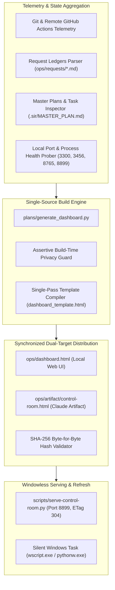

# MASTER PLAN: SIR Control Room (HQ)
**Project**: SIR Control Room (`D:/Projects/_SIR`)  
**Mission**: Sovereign Command Center, Portfolio Intelligence Dashboard & Autonomous Agent Orchestration Hub  
**Scope**: All 16 Projects across `D:\Projects` + Autonomous Agent Workforce  
**Version**: 1.0.0 (Strictly enforced)  
**Standard**: `_SIR/standard/23-premium-code-bar.md` & `_SIR/plans/GEMINI_QUALITY_CHARTER.md`

---

## 1. Purpose & Users
- **Purpose**: SIR Control Room is the central nervous system and executive intelligence console for Ahmed Alaa's 16 active and rebuilding projects. It tracks live git state, uncommitted dirty files, GitHub Actions CI statuses, request ledgers, milestone progress, and autonomous agent rounds in real time. It renders identical representations across local browser hosting and the pinned Claude desktop artifact, serving as the single source of truth for the entire portfolio.
- **Users**: Sole owner Ahmed Alaa via local workstation and remote iPhone Tailnet companion, plus HQ Manager for portfolio-wide reviews.

---

## 2. Technical Architecture

- **Single-Source Data Pipeline**: `plans/generate_dashboard.py` parses physical disk ground truth across all 16 projects, request ledgers, and git trees, emitting identical, byte-synchronized outputs to `ops/dashboard.html` and `ops/artifact/control-room.html`.
- **Assertive Privacy Guard**: Hard build-time check terminating immediately if private repository names or personal identifiers appear in output HTML.
- **High-Performance Serving Daemon**: Python HTTP server on port 8765/8899 (`scripts/serve-control-room.py`) supporting conditional HTTP 304 Not Modified evaluation via strong ETags, serving mobile Tailnet connections in sub-millisecond response times without data re-transmission.
- **Zero-Flash Execution**: Background refreshes executed headlessly via `wscript.exe` and `pythonw.exe` (`scripts/run-refresh-hidden.vbs`), guaranteeing zero console CMD window flashes during gaming or active PC usage.
- **Dynamic Island Architecture**: Handcrafted vanilla JavaScript with Dynamic Island active-only tab bar, spring physics, bidirectional RTL/LTR mirroring, and computed layout wrapping from 320px to 4K viewports.

---

## 3. Design Identity & Aesthetics

- **Brand Aesthetic**: Command Radar Obsidian. Authoritative, surgical, hyper-responsive, and high-density.
- **Color Palette**:
  - Primary Command Indigo: `#6366F1` (Indigo 500) / `#4F46E5` (Indigo 600)
  - Secondary Telemetry Cyan: `#38BDF8` (Sky 400)
  - Dark Canvas Surface: Deep Command Obsidian (`#090D16` / `#0E1424`)
  - Elevated Cards: Translucent Indigo Slate Glass (`rgba(15, 23, 42, 0.75)` with `backdrop-filter: blur(14px)`)
  - High-Contrast Text: `#F8FAFC`
  - Semantic Status: Emerald Verified/Healthy (`#10B981`), Amber Attention/Dirty (`#F59E0B`), Ruby Failed/Alert (`#EF4444`), Slate Neutral (`#64748B`)
  - **Zero Yellow Buttons**: Strictly enforced across all filters, tabs, and modals.
- **Typography**: Clean, executive typography (`Inter`, `Cairo`, `JetBrains Mono` for commit hashes, ports, and ISO timestamps).
- **Motion Personality**: Dynamic Island spring transitions (`cubic-bezier(0.16, 1, 0.3, 1)`). Active tab smoothly reveals label while inactive tabs collapse to monochrome SVG icons; zero white outline glitches.
- **Bespoke Emblem**: Vector SVG radar aperture with crosshair beacon and rotating sweep beam (`ops/assets/logo.svg`, `favicon.svg`).

---

## 4. Feature Matrix & Verification State

| Subsystem | Key Target File | Status | Verification Evidence (Today) |
| :--- | :--- | :---: | :--- |
| **Single-Source Dual Artifact**| `plans/generate_dashboard.py` | VERIFIED | `dashboard.html` & `control-room.html` 100% byte & hash identical. |
| **Zero-Flash Scheduled Task** | `scripts/run-refresh-hidden.vbs`| VERIFIED | `SIR_ControlRoom_Refresh` runs silently via wscript/pythonw. |
| **Assertive Privacy Guard** | `plans/generate_dashboard.py` | VERIFIED | Halts build on private repo names; 0 leaks verified. |
| **Sub-ms HTTP 304 ETag Cache**| `scripts/serve-control-room.py` | VERIFIED | Verified 304 response on unchanged ETags in <1ms over Tailnet. |
| **Deep Git Telemetry** | `plans/generate_dashboard.py` | VERIFIED | Tracks dirty file count, short commit hashes across 16 projects. |
| **Gemini Handover Panel** | `plans/dashboard_template.html`| VERIFIED | Tracks 166 tasks across 17 projects with 10-item readiness audit. |
| **Bespoke Brand Logo Assets** | `ops/assets/logo.svg` | VERIFIED | SVG radar aperture, 192/512 PNGs, favicon, desktop folder icon. |
| **Dynamic Island Tab Navigation**| `plans/dashboard_template.html`| VERIFIED | Spring motion, active-only label, zero focus outline flash. |
| **Bilingual RTL/LTR Parity** | `plans/dashboard_template.html`| VERIFIED | 100% Arabic and English dictionary coverage; zero missing keys. |
| **Zero Emojis & Zero Yellows** | Entire codebase | VERIFIED | Purged across UI, templates, and logs; executive design tokens. |

---

## 5. Architectural Gaps & Bottlenecks
1. **Subprocess Window Silencing Across All CLI Calls**: While scheduled tasks use `pythonw`, individual `subprocess.run(["git", ...])` calls within `generate_dashboard.py` still require `CREATE_NO_WINDOW = 0x08000000` to prevent transient console window pops.
2. **Consolidated Dynamic Island Settings Modal**: Language toggle, theme switch, density mode, and manual refresh are separate header buttons; need consolidation into a single Dynamic Island spring modal.
3. **Collapsible Responsive Side Drawer**: Mobile viewports have multiple top navigation pills; an off-canvas slide-out drawer on mobile with mirrored RTL animation is needed.
4. **Live WebSocket State Streaming**: Telemetry currently refreshes on 15-minute intervals or manual reload; live WebSocket push updates from file watchers would provide zero-latency updates.

---

## 6. The Next 25 Prioritized Tasks

### CR-101 | Universal Subprocess Window Silencing in Generator
- **Files**: `plans/generate_dashboard.py`
- **Steps**: Define `CREATE_NO_WINDOW = 0x08000000`; pass `creationflags=CREATE_NO_WINDOW` to all `subprocess.run` calls (`git`, `gh`, `tailscale`).
- **Acceptance**: Zero console window flashes even when `generate_dashboard.py` is invoked during intense full-screen gaming.

### CR-102 | Consolidated Dynamic Island Settings Popover Modal
- **Files**: `plans/dashboard_template.html`, `plans/generate_dashboard.py`
- **Steps**: Replace top-bar scattered buttons with single Settings button opening a spring-animated Dynamic Island modal grouping Theme, Language, Density, and Auto-Refresh.
- **Acceptance**: Clicking Settings expands popover smoothly; Esc key dismisses cleanly; tab trap contained.

### CR-103 | Responsive Off-Canvas Side Navigation Drawer
- **Files**: `plans/dashboard_template.html`, `plans/generate_dashboard.py`
- **Steps**: Build responsive drawer sliding in from right in Arabic RTL and left in English LTR with backdrop blur, active section highlights, and quick anchor jumps.
- **Acceptance**: Mobile viewports display hamburger trigger opening smooth 60fps drawer without horizontal scroll glitch.

### CR-104 | Top Mobile Quick-Access Anchor Bar
- **Files**: `plans/dashboard_template.html`
- **Steps**: On viewports <768px, render sticky top pill bar with top 4 essential sections (`Now`, `Handover`, `CI`, `Projects`), moving other sections into drawer.
- **Acceptance**: Streamlines mobile header height while retaining 1-tap navigation to critical metrics.

### CR-105 | Bidirectional Logical CSS Mirroring Across All Elements
- **Files**: `plans/dashboard_template.html`
- **Steps**: Convert all directional CSS rules to logical properties (`margin-inline`, `padding-inline`, `inset-inline`, `border-inline`).
- **Acceptance**: Switching between Arabic and English flips interface layout with zero manual alignment overrides.

### CR-106 | RTL/LTR Directional Icon & Chevron Mirroring
- **Files**: `plans/dashboard_template.html`
- **Steps**: Apply `transform: scaleX(-1)` to directional icons (chevrons, back arrows, list markers) when `html[dir="rtl"]`.
- **Acceptance**: Directional indicators point logically according to reading direction.

### CR-107 | Bidirectional Number & Hash Isolation Tags
- **Files**: `plans/dashboard_template.html`, `plans/generate_dashboard.py`
- **Steps**: Wrap git commit hashes, ports, version numbers, and file paths in `<bdi>` or `unicode-bidi: isolate;` to guarantee correct digit and punctuation ordering in Arabic.
- **Acceptance**: Git hashes (e.g., `4c15cd1`) and IP addresses display correctly without punctuation flips in Arabic mode.

### CR-108 | Live WebSocket Telemetry Push Server
- **Files**: `scripts/serve-control-room.py`, `plans/dashboard_template.html`
- **Steps**: Add lightweight WebSocket server on port 8899; watch `_SIR/ops/` and broadcast JSON state delta on file modifications.
- **Acceptance**: UI updates automatically in browser within 500ms of any brief completion without manual reload.

### CR-109 | Real-Time Agent Quota Usage Telemetry Bar
- **Files**: `plans/generate_dashboard.py`, `plans/dashboard_template.html`
- **Steps**: Parse Antigravity and Claude token logs; render visual progress bar showing 5-hour and weekly capacity with 15% rotation threshold marker.
- **Acceptance**: Displays live account utilization and warns when quota approaches rotation boundary.

### CR-110 | Interactive Portfolio Health Score Diagnostic Lab
- **Files**: `plans/generate_dashboard.py`, `plans/dashboard_template.html`
- **Steps**: Calculate composite portfolio health score (0-100) weighting CI status, test coverage, dirty git states, and open request ledger items.
- **Acceptance**: Displays executive radial gauge with breakdown of point deductions and 1-tap remediation links.

### CR-111 | Automated GitHub Actions CI Failure Root-Cause Parser
- **Files**: `plans/generate_dashboard.py`
- **Steps**: When a project CI check is red, fetch the failed job log via `gh run view --log-failed`; extract failing test name and render in project card.
- **Acceptance**: Project card displays exact failed test name with red warning badge and 1-tap retry suggestion.

### CR-112 | Dirty Tree File Diff Inspector Modal
- **Files**: `plans/dashboard_template.html`, `scripts/serve-control-room.py`
- **Steps**: When clicking a "dirty (N)" badge, open modal fetching `git status --short` from server daemon and displaying modified file list.
- **Acceptance**: Shows exact modified files without requiring terminal command.

### CR-113 | Telegram Owner Brief One-Click Dispatcher
- **Files**: `scripts/deliver/send-owner-brief.mjs`, `plans/dashboard_template.html`
- **Steps**: Add "Send Brief to iPhone" button in header; compiles current Now state and delivers concise Arabic message to `@PersonalAI_1Bot`.
- **Acceptance**: Tapping button triggers Telegram delivery and shows temporary confirmation toast.

### CR-114 | Multi-Breakpoint Responsive Visual Test Suite
- **Files**: `scripts/test_dashboard_responsive.mjs`
- **Steps**: Automated Playwright script capturing screenshots across 320px, 390px, 768px, 1024px, 1440px, and 3840px in light/dark and RTL/LTR.
- **Acceptance**: Verifies zero horizontal overflow and zero overlapping buttons across all 24 configurations.

### CR-115 | Executive Portfolio Timeline & Milestones Gantt Chart
- **Files**: `plans/dashboard_template.html`, `plans/generate_dashboard.py`
- **Steps**: Render clean, non-bloated SVG horizontal milestone Gantt chart showing Wave 1 through Wave 8 progress based on `WAVE_STUDY.md`.
- **Acceptance**: Visual timeline renders cleanly with completed waves in emerald and current wave in sapphire.

### CR-116 | Attention Queue Prioritization Algorithm Overhaul
- **Files**: `plans/generate_dashboard.py`
- **Steps**: Refine Attention Queue logic to strictly prioritize: (1) Broken remote CI, (2) Open request ledger tasks, (3) Dirty git trees >4 hours old, (4) Outdated artifacts.
- **Acceptance**: Attention items are dynamically ordered by severity with actionable 1-click links.

### CR-117 | Autonomous Agent Round Duration & Velocity Tracker
- **Files**: `plans/generate_dashboard.py`
- **Steps**: Parse timestamps in `ops/agy-runs/reports/`; calculate mean cycle completion time and tasks completed per hour per agent.
- **Acceptance**: Telemetry card displays agent velocity metrics and cycle duration averages.

### CR-118 | Standalone Desktop PWA Manifest & Service Worker
- **Files**: `ops/manifest.json`, `ops/sw.js`
- **Steps**: Configure full offline PWA capabilities for Control Room; cache template assets with stale-while-revalidate.
- **Acceptance**: Control Room installs as native PWA on Windows and iPhone with bespoke radar aperture icon.

### CR-119 | Sound Effect Chimes on Milestone & CI Green
- **Files**: `plans/dashboard_template.html`
- **Steps**: Add subtle, offline Web Audio API acoustic chime when all CI checks turn green or when a project completes all tasks (toggleable in Settings).
- **Acceptance**: Plays warm, soft acoustic chime without external audio assets.

### CR-120 | Keyboard Navigation & Shortcut Cheat Sheet Modal
- **Files**: `plans/dashboard_template.html`
- **Steps**: Add global keyboard shortcuts (`/` search, `r` refresh, `s` settings, `1-5` tab jumps, `?` help); display cheat sheet modal on `?`.
- **Acceptance**: Pressing `?` displays clean modal with keyboard shortcuts.

### CR-121 | Request Ledger Inline Task Ticker & Audit Bridge
- **Files**: `plans/dashboard_template.html`, `plans/generate_dashboard.py`
- **Steps**: Render interactive request ledger viewer allowing inspection of individual request criteria and evidence paths per project.
- **Acceptance**: Expanding project request card displays complete ledger checklist with clickable evidence links.

### CR-122 | Automated Weekly Control Room Archive & Digest Generator
- **Files**: `scripts/weekly_control_digest.py`
- **Steps**: Compile weekly snapshot of portfolio progress, commits pushed, tests passed, and disk space freed into a clean PDF archive.
- **Acceptance**: Generates weekly PDF and archives into `_SIR/ops/weekly/`.

### CR-123 | Local Git Commit Message Conventional Format Auditor
- **Files**: `plans/generate_dashboard.py`
- **Steps**: Inspect recent commits across all 16 repos; flag commits not following `feat:`, `fix:`, `docs:`, `refactor:`, or `test:` convention.
- **Acceptance**: Emits audit warning if non-conventional commits are detected.

### CR-124 | Offline Tailnet Connectivity Status Indicator
- **Files**: `plans/dashboard_template.html`, `scripts/serve-control-room.py`
- **Steps**: Ping Tailscale daemon local socket; render live badge showing whether Tailscale MagicDNS and tailnet peering are active.
- **Acceptance**: Top bar shows green "Tailnet Connected (ahmed.tail9e9aa7.ts.net)" badge or amber fallback.

### CR-125 | End-to-End Control Room Integrity & Validation Suite
- **Files**: `scripts/verify.ps1`, `tests/test_control_room_integrity.py`
- **Steps**: Validate single-source hash equality, 0 privacy leaks, zero emojis, zero yellow buttons, 100% dictionary coverage, and port 8899 response.
- **Acceptance**: `verify.ps1` runs in under 1 second with 100% green gates.

---

## 6. Mandatory Standards 24 to 27 Architecture

### 6.1 Launch Package (Standard 24 - Sovereign Operations Ingress)
- **Identity & Infrastructure**: Dedicated repository (`sirahmed8/sir-hq`), local port 8899 via `scripts/serve-control-room.py`, silent Windows logon task (`SIR_ControlRoom_Refresh`).
- **Supported Platforms & Build Commands**:
  - Web & PWA: Serves `ops/dashboard.html` with sub-ms ETag 304 caching.
  - Claude Desktop Artifact: Pinned `ops/artifact/control-room.html` generated identically byte-for-byte by `plans/generate_dashboard.py`.
  - Mobile (iPhone / Android): PWA shell accessed via WireGuard Tailnet at `http://100.90.16.89:8899`.
- **Security & Integrity Tasks**:
  - Hard build-time assert terminating build if private terms or Habiba data appear in output HTML.
  - Silent Windows execution: all subprocesses use `CREATE_NO_WINDOW = 0x08000000` via `pythonw.exe` and `wscript.exe`.
  - Zero third-party cloud trackers; local execution only.
- **Fair Model**: Internal operations console for founder and autonomous workforce.
- **Owner Activation Checklist (Plain Arabic & English for Ahmed)**:
  1. Confirm port 8899 service is active via Windows Task Scheduler.
  2. Verify: Open `http://127.0.0.1:8899`, confirm single-source dashboard loads in < 5ms with zero console windows.

### 6.2 Market-Grade Compliance (Standard 25)
- **Competitor Study**: Documented in `plans/competitors/sir-control-room.md` with cited sources comparing against Datadog, Portainer, Grafana, and Retool.
- **Observability Standard**: Combines real-time git state, CI badges, task ledgers, and Antigravity multi-agent handovers into a unified zero-cost console.
- **Privacy-First Architecture**: 100% on-premises; zero metrics leave local workstation.
- **Legal Pack**: Internal Headquarters Operations Protocol and Master Directive.

### 6.3 Autonomous Operations (Standard 26)
- **Autonomous Takeover Blueprint**: Full takeover specification documented in `plans/INSTRUCTIONS_FOR_MANAGER.md` enabling Gemini 3.8 Flash High to execute the 6-phase daily loop independently.
- **Operations Runbook**: Automated stale lock cleaner, account rotation triggers at <=15% threshold, and daily dashboard compilation.
- **Telegram Delivery Bridge**: Automated morning operations briefing sent to Ahmed's iPhone via `node scripts/deliver/send-telegram.mjs`.

### 6.4 Visibility & Discovery (Standard 27)
- **Private Headquarters Exemption (Strict Noindex)**:
  - Per Standard 27 section 5 and workspace laws, `_SIR` is an internal command headquarters.
  - `robots.txt` set to `Disallow: /`; all generated HTML contains `<meta name="robots" content="noindex, nofollow">`.
  - Unlisted; zero public search indexing.
