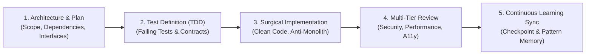

# Agent Supercharged OS (Everything Claude Code Discipline)

A structured software engineering operating system that transforms the coding agent into a disciplined engineering team through phased workflows, test-driven validation, and continuous learning.

---

## 1. The 4-Phase Engineering Pipeline

---

## 2. Operating Standards

1. **Phase 1: Architecture & Plan**:
   - Never write code before producing an architectural breakdown.
   - Define data schemas, API routes, database indices, and error conditions up front.
2. **Phase 2: Test-Driven Validation**:
   - Write unit and integration tests before or alongside feature implementation.
   - Ensure boundary conditions (null values, invalid payloads, network timeouts) are exercised.
3. **Phase 3: Surgical Implementation**:
   - Maximum 300 lines per file. Enforce layered architecture (Presentation -> Domain -> Data -> Core).
   - Zero placeholder stubs, zero unhandled promises.
4. **Phase 4: Multi-Tier Review**:
   - **Security Review**: Check against OWASP Top 10, auth flaws, and injection vectors.
   - **Performance Review**: Check for N+1 queries, unnecessary re-renders, and bundle bloat.
   - **Accessibility Review**: Check keyboard navigation, contrast, and ARIA attributes.
5. **Phase 5: Continuous Learning & Session Checkpointing**:
   - Update `continuation_checkpoint.md` with active tasks, key design decisions, and learned lessons so progress persists seamlessly across sessions.
