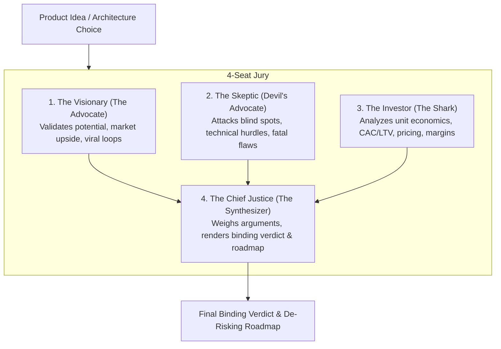

# Claude Council (Shark Tank Advisory & Council of Rivals)

A 4-perspective evaluation framework that stress-tests startup concepts, product ideas, and architectural decisions before writing a single line of code.

---

## 1. The 4-Seat Advisory Jury

---

## 2. Seat Mandates & Scrutiny Protocol

1. **Seat 1: The Visionary (The Advocate)**
   - Identifies the unfair advantage, timing catalyst, and viral loop.
   - Formulates the best-case growth thesis: *Why will customers fall in love with this?*

2. **Seat 2: The Skeptic (Devil's Advocate)**
   - Ruthlessly probes for failure modes: *Why will this fail within 90 days?*
   - Examines retention killers, friction points, legal vulnerabilities, and competitive moats of incumbents.

3. **Seat 3: The Investor (The Shark)**
   - Cares only about cash flow and financial viability:
     - *What is the pricing model? (EGP / USD)*
     - *What is the estimated Customer Acquisition Cost (CAC) vs Lifetime Value (LTV)?*
     - *Can this reach profitability without venture capital burning?*

4. **Seat 4: The Chief Justice (The Synthesizer)**
   - Synthesizes conflicting arguments into an objective verdict:
     - **Verdict**: `GREEN LIGHT` (Proceed with current plan), `YELLOW LIGHT` (Proceed only after fixing critical flaw), or `RED LIGHT` (Kill or pivot).
     - **De-Risking Action Plan**: 3 immediate experiments or prototypes to validate the most lethal assumption within 48 hours.
