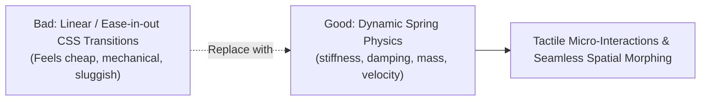

# Emil Motion & Impeccable Design System

Combines Emil Kowalski's motion physics and animation craft with the Impeccable 23-heuristic design system to make web applications feel tactile, expensive, and bespoke.

---

## 1. Emil Kowalski Motion Physics Core

### Motion Doctrine:
1. **Never Use Linear Transitions**: Standard `transition: all 0.3s ease` feels artificial. Use physics-based springs (e.g. Framer Motion, Motion One, or Tailwind CSS spring transitions).
2. **Spring Tokens**:
   - **Snappy / Micro-Interactions (Buttons, Toggles, Tabs)**: `stiffness: 400, damping: 30, mass: 0.8` (<180ms response).
   - **Fluid / Layout Morphing (Modals, Drawers, Cards)**: `stiffness: 300, damping: 28, mass: 1.0` (<300ms settling time).
   - **Tactile Active Press**: `active:scale-[0.98]` with instant rebound.
3. **Staggered Orchestration**: When lists or grid items mount, stagger by 30–50ms per item (`staggerChildren: 0.04`). Never pop all elements simultaneously.
4. **Layout Continuity**: An expanding card should morph smoothly from its trigger geometry using shared layout animations (`layoutId`).

---

## 2. Impeccable Design Heuristics (Layout, Fonts, Spacing)

1. **Fluid Typography Clamp**: Never jump abruptly between mobile and desktop font sizes. Use `clamp(1rem, 0.85rem + 0.75vw, 1.5rem)`.
2. **Optical Alignment**: Circular icons and arrows need 1–2px manual optical compensation to center correctly relative to surrounding text.
3. **Spacing Rhythm**: Strictly adhere to 4px/8px incremental tokens (`4px`, `8px`, `12px`, `16px`, `24px`, `32px`, `48px`, `64px`). Never use arbitrary values like `17px` or `29px`.
4. **Line-Height Proportions**: Tighter line height for large headings (`leading-tight` / 1.1–1.2); generous line height for body paragraphs (`leading-relaxed` / 1.5–1.65) to maximize legibility.
5. **Headings Balance**: Apply `text-wrap: balance` to all headers; apply `text-wrap: pretty` to body copy to avoid orphan words.
