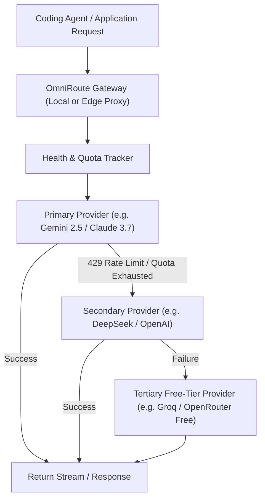

# OmniRoute Resilience Gateway (Multi-Provider Model Routing)

Architecture and patterns for resilient, high-availability AI gateways that route requests across multiple LLM providers and automatically fail over upon rate limits or quota depletion.

---

## 1. Gateway Routing Architecture

---

## 2. Failover & Routing Policies

1. **Intelligent Tier Chaining**:
   - Chain providers based on latency, quality, and cost tiers.
   - High-reasoning requests -> Route to primary reasoning models.
   - Quick completions / linter checks -> Route to fast, low-cost/free models (e.g. Gemini Flash, Groq Llama 3).
2. **Circuit Breaking & Exponential Backoff**:
   - When a provider returns `429 Too Many Requests` or `RESOURCE_EXHAUSTED`, mark that provider's circuit as `OPEN` for the duration specified in the `Retry-After` header.
   - Automatically redirect pending and new requests to the next healthy provider in the pool.
3. **Unified Interface Normalization**:
   - Standardize request/response payloads to the OpenAI-compatible or Anthropic Messages schema so client harnesses require zero code changes when switching models.
