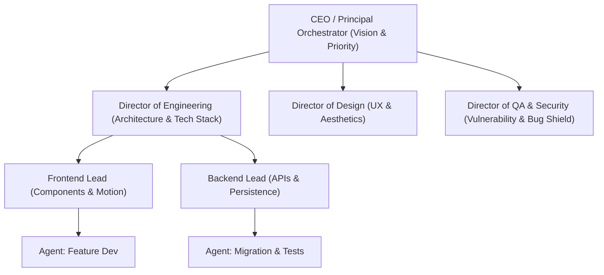

# Paperclip Multi-Agent Company Orchestrator

Meta-harness orchestration that structures autonomous agents into an integrated virtual company with clear roles, reporting chains, task delegation, and approval gates.

---

## 1. Company Org Chart Architecture

---

## 2. Multi-Harness Delegation Protocol

1. **Heartbeat & Status Monitoring**:
   - Each subordinate agent receives structured tasks with explicit scope, inputs, expected outputs, and token/time budgets.
   - Status transitions: `Assigned` -> `Running` -> `Review` -> `Completed` / `Blocked`.
2. **Cross-Harness Interoperability**:
   - Orchestrates across available runtimes:
     - **Antigravity**: Complex multi-file orchestration, visual DevTools validation, deep codebase refactors.
     - **Claude Code**: Terminal CLI execution, rapid bash commands, focused edits.
     - **Codex / OpenCode / Kilo**: Autonomous background tasks and isolated testing.
3. **Approval Gates & Governance**:
   - Destructive actions (database migrations, production deployments, secret changes) require CEO / Human sign-off.
   - Quality gates: Code must pass static linting, unit tests, and security scanning before being merged into main branch.
