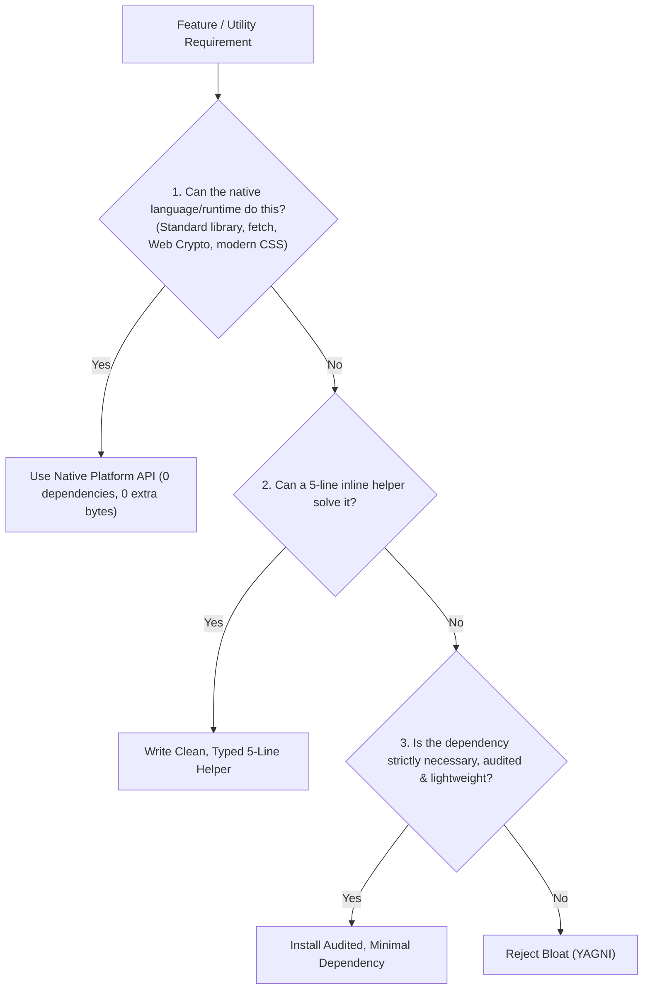

# Ponytail YAGNI Optimizer (Senior Minimalist Engineering)

Cuts over-engineering, code bloat, and context consumption by enforcing the "Lazy Senior Developer" filter and prioritizing platform-native primitives over third-party dependencies.

---

## 1. The YAGNI Question Ladder

Before adding any new dependency, abstraction layer, or helper utility, evaluate:

---

## 2. Token-Saving & Anti-Bloat Substitutions

- **Native Fetch instead of Axios**: Modern Node 18+ and browsers have `fetch`, `AbortController`, and `FormData` built-in.
- **Modern CSS instead of Complex JS Libraries**:
  - CSS `:has()`, Container Queries, and `dialog` element replace heavy JS modal/dropdown managers.
  - CSS `@starting-style` and View Transitions API replace heavyweight animation runtimes for basic dialog/reveal transitions.
- **Native Web Crypto instead of `crypto-js`**: Use `crypto.subtle` for hashing, HMAC, and random UUID generation (`crypto.randomUUID()`).
- **Standard Date handling instead of Moment.js**: Use native `Intl.DateTimeFormat` or lightweight `date-fns` functions instead of 70KB Moment.js bundles.
- **Surgical Code Generation**: Never generate 300 lines of boilerplate when 40 lines of elegant, readable code fulfill the requirements.
