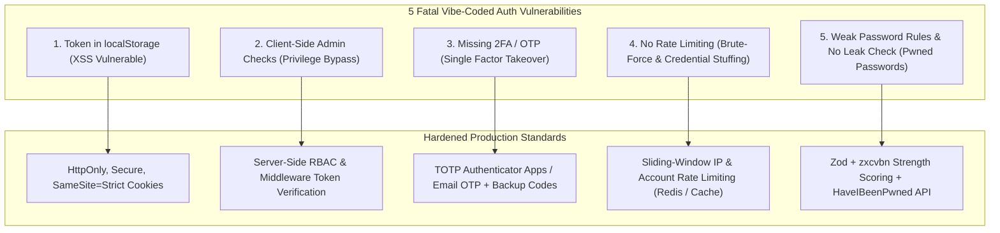

# Vibe-Coded Auth Hardening Shield

Eliminates the five most common and severe authentication vulnerabilities created by rapid AI vibe-coding and establishes production-grade identity security.

---

## 1. The 5 Fatal Flaws & Required Fixes

---

## 2. Implementation Specifications

### Flaw 1: Session Token in `localStorage`
- **Vulnerability**: Any XSS vulnerability allows malicious JavaScript to execute `localStorage.getItem('token')` and hijack the account.
- **Hardening**:
  - Store tokens strictly in **`HttpOnly; Secure; SameSite=Strict`** cookies.
  - Implement short-lived Access Tokens (15 min) + Refresh Tokens stored in partitioned database tables with rotation on each refresh.

### Flaw 2: Client-Side Admin Checks
- **Vulnerability**: Inspecting `user.role === 'admin'` inside a React component or routing guard without server validation allows attackers to toggle state in browser DevTools.
- **Hardening**:
  - Protect all sensitive mutations and data endpoints with **server-side middleware**.
  - Validate role claims cryptographically on every request against the database or verified JWT signature.

### Flaw 3: Missing 2FA / OTP Flow
- **Hardening**:
  - Provide standard Time-based One-Time Password (TOTP) compatible with Google Authenticator / 1Password using `speakeasy` or `otplib`.
  - Issue 8 single-use cryptographically random backup recovery codes hashed with Argon2id/bcrypt in the database.

### Flaw 4: Missing Rate Limiting on Login & Password Reset
- **Vulnerability**: Allows automated bot attacks to guess passwords and flood email dispatch quotas.
- **Hardening**:
  - Enforce sliding-window rate limits:
    - **Per-IP**: Max 10 attempts per 15 minutes.
    - **Per-Account**: Max 5 failed attempts per 15 minutes; trigger account lock and notification email on excess failures.
  - Apply progressive delays (exponential backoff) after consecutive failed attempts.

### Flaw 5: Weak Passwords & Missing Breach Verification
- **Hardening**:
  - Frontend & Backend validation with Zod + `zxcvbn`: minimum 10 characters, requiring mixed case, digits, and symbols.
  - Check against the **HaveIBeenPwned Pwned Passwords API** using k-Anonymity (submitting only the first 5 characters of SHA-1 hash to verify the password hasn't appeared in known data breaches).
