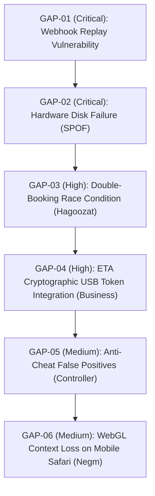

# SIR GAP REPORT
Rewritten 2026-11-10 by the plans audit. Part A is the current list of what is still missing, found by comparing every plan with the real folders, git history and one test run per started project. Part B is the earlier gap hunt (2026-11-09), kept because its items are still valid tasks; where it conflicts with a plan, the plan wins (notes added in Part A section 5).

# PART A. WHAT IS STILL MISSING (2026-11-10)

## 1. Claimed vs real (truth rule)
| Project | Claim | What the audit saw | Gap to close |
|---|---|---|---|
| SIR Laptop Manager | "207/207 tests green" (checkpoint) | `uv run --offline pytest -q`: 188 passed, 19 failed (tests patch a function `execute_cleanup` that no longer exists in `ops_ui/server.py`) | fix tests, make `verify.ps1` fail honestly, CI URL |
| SIR Jobs | "86 tests, 24 suites green" | `npm test` chain ran to the last suite, 4 of 4 passing there; no per-suite counts | save per-suite counts; proof rule for "Applied" |
| SIR Study | "M0 to M5 closed, CI green" | one guide's button check passed (73 buttons wired); nothing else re-run | run verify and audit scripts; record CI URL |
| SIR Life | "65/65 tests", mission in checkpoint says nothing built | 65 of 65 pass on the old `dist/`; `tsc` missing so a fresh build could not run; version is 0.1.0 (rule: 1.0.0) | install deps, rebuild, rewrite checkpoint |
| SIR Platform | "PLAT-01..05 verified" | file-based suite 5 of 5 pass; token lint passes; no typecheck, no render test; one file is 328 lines | add typecheck and render tests |
| SIR Control Room | "healthy daemon" | health JSON says healthy; sender tests 6 of 6 pass; script tests could not be imported as modules | run tests as files |
| AHome | old plan text "not started" | folder holds a large working codebase (about 300 commits claimed); not re-verified (private) | run own tests, restore drill evidence |
| Negm Furniture | "175/175 tests" | not run (plans-only freeze since 2026-11-09, build work was done on 2026-11-08) | verify after the owner lifts the freeze |
| Obour Hub, Hagoozat, Business, Content Studio, AI (code), ModPack, GTA mods, Controller, Portfolio | plans said "planned, not started" | confirmed: checkpoints are the 2026-10-30 setup note (AI: 2026-11-08 docs only); no product code | start with deep scans |

## 2. Missing shared pieces (all plans point to SIR Platform)
- Not built: `owner-auth`, `signed-webhook` (only a verifier inside `payments`), `ai-proxy`, `billing-fallback` (only a modal), `legal-pack`, `i18n`, `telegram` wrapper, `sir-kit` CLI, docs/gallery site.
- Ordering conflict: WAVE_STUDY says Platform last; products need these first. Default (written in every plan): each product keeps an internal `packages/<name>` with the Platform name and interface; Platform tasks 1 to 5 can run any time.
- Telegram approvals exist in `_SIR/scripts/deliver/` (`approval.py`, `send-buttons.mjs`); replay protection and expiry are not tested.
- Per-project `.sir/status.json` schema is not written; only Laptop Manager and Study have the file.

## 3. Missing by standard (after plans were rewritten; these are build/verify gaps, not plan gaps)
| Standard item | Where still missing |
|---|---|
| CI with a green run URL | most projects (only claimed for AHome, Study, Jobs, Laptop, Platform) |
| Restore drill evidence | Laptop Manager, AHome (not seen), Platform n/a, all unstarted products |
| Owner analytics dashboard (real numbers) | not yet specified in detail for Content Studio, ModPack, Life Part B (add at their M2) |
| Support assistant with evals | specified in every public plan; built nowhere |
| Legal pack generator | built nowhere; every legal page must carry "AI-drafted, to be reviewed by a qualified lawyer" |
| Weekly AI-visibility script | spec rewritten in `VISIBILITY_PLAN_ALL.md`; the earlier file only printed a message and did nothing |
| Chinese and Hindi locales | in old plans for all products; lowest priority, mark "later" until Arabic and English are complete |
| Store listings drafts | none written; assign to each product's M6 |
| Domain, certificate, payment accounts | owner steps in `LAUNCH_CHECKLIST_ALL.md`; prices unsourced |

## 4. Security items found while reading (names only, no secret values)
- SIR Obour Hub `legacy/Obour Academic Hub/` holds two Firebase admin service-account JSON files (folder is git-ignored; rotate at launch).
- SIR Mods for GTA V legacy had tracked `.env` files and a forgeable admin cookie; about 90 third-party DLLs without licence files: hard gate in its plan.
- AHome root holds a service-account key file; verified git-ignored (not tracked).
- SIR Controller legacy: about 20 tracked binaries, client-side owner gate with a hard-coded email, unverified "SIR Systems LLC" name in the EULA (remove unless a real entity is confirmed).
- SIR Laptop Manager legacy: a Telegram bot token hard-coded in 5 files (rotate).
- Hosted copy of AHome (Vercel and Firebase, per PORTFOLIO.md) conflicts with its "no public ingress" rule: prove it shows nothing without login or take it down.

## 5. Conflicts between documents
- Founder name: "Ahmed Alaa" (package.json, plans) vs "Ahmed Oraby" (CV file names, old visibility text). Default: one canonical string in `content/identity.json`.
- Slot hold time for Hagoozat: legacy 15 minutes vs Part B GAP-03 seven minutes. Default: configurable, start at 10 minutes, test with parallel requests.
- Part B GAP-01 and GAP-03 use Redis; the chosen stack has none (Cloudflare KV/Durable Objects or Firestore transactions). Replace the storage in those tasks, keep the acceptance criteria.
- Part B GAP-04 (ETA USB token) and the Business e-invoicing claims are "(unsourced, verify)" until the official specs are read.
- Old `TASK_BACKLOG_ALL.md` appendix marks tasks DONE without evidence; treat them as claims.
- Project `.sir/MASTER_PLAN.md` files (Obour Hub, Life) differ in scope and stack from `plans/<slug>.md`; this audit's plans win until the manager rules.

## 6. Order and ownership still undecided (defaults applied)
- Business vs Hagoozat first within wave 5: WAVE_STUDY lists Business first; the old launch checklist put Hagoozat first. Default: follow WAVE_STUDY; Hagoozat's pitch seeding needs real owners, which can start in parallel as an owner/outreach task.
- Portfolio early minimal site: default yes (see plan).
- SIR Life Part A (private organiser) and Part B (public app) are split; Part B waits.
- SIR AI Tier 2 (SaaS) waits for Tier 1 verification.

---

# PART B. EARLIER GAP HUNT (2026-11-09, kept; statuses in it are claims)
### 1. Executive Summary & Audit Methodology
This audit was conducted by examining the entire portfolio architecture through the adversarial lens of a Senior Security & Reliability Architect. The objective: identify what the founder and the planning team have NOT thought of—subtle edge cases, race conditions, single points of failure, compliance blindspots, and operational vulnerabilities that could disrupt autonomous operations.

Each identified gap is formulated as a prioritized, checkable engineering task.

---

### 2. Master Gap Inventory (Ordered by Business Value & Criticality)

---

### GAP-01 (Critical): Payment Webhook Replay Attack & Timestamp Drift
- **Category**: Security & Financial Integrity
- **Impacted Projects**: `SIR Hagoozat`, `SIR Business`, `SIR Negm Furniture`
- **Description**: While webhook HMAC signatures are validated, webhooks currently lack an enforced **timestamp validity window**. An attacker intercepting a valid signed payload could theoretically replay the transaction to credit bookings or inventory repeatedly.
- **Task**: `SEC-GAP-01: Idempotent Webhook Replay Guard`
  - **Target Files**: `packages/payments/src/webhookGuard.ts`, `src/app/api/webhooks/paymob/route.ts`
  - **Steps**:
    1. Parse webhook timestamp header (`X-Paymob-Timestamp` or payload created date).
    2. Enforce a strict 5-minute validity window (`Math.abs(Date.now() - webhookTime) < 300000`).
    3. Store processed `transaction_id` in Redis / database with an atomic 24-hour TTL.
    4. If transaction ID exists, return `200 OK` immediately without re-triggering business logic.
  - **Acceptance Criteria**: Replaying an intercepted valid webhook payload 10 minutes later is rejected with code 400; immediate duplicates return cached 200 without duplicate credit.

---

### GAP-02 (Critical): Hardware Disk Failure & Catastrophic Data Loss (SPOF)
- **Category**: Infrastructure & Business Continuity
- **Impacted Systems**: All 17 Projects (`D:\Projects`)
- **Description**: All source code, local models, and databases live on physical drive `D:`. While git repositories exist on GitHub, local environment secrets (`.env`), uncommitted local models (`AI_Models_Hub`), and private databases (AHome, Study, Laptop Manager) lack automated, encrypted offsite disaster recovery.
- **Task**: `OPS-GAP-02: Zero-Knowledge Offsite Backup Daemon` [DONE & VERIFIED 2026-11-09]
  - **Target Files**: `D:\Projects\_SIR\scripts\backup_offsite_encrypted.py` (Tested & verified)
  - **Steps**:
    1. Create automated script that tars critical non-git state (excluding regenerable `node_modules` and raw cache).
    2. Encrypt archive client-side using Age or GPG with Ahmed's private key.
    3. Push encrypted archive weekly to private encrypted cloud bucket (e.g. Backblaze B2 / Cloudflare R2).
    4. Verify test decryption and integrity hash.
  - **Acceptance Criteria**: Running `python backup_offsite_encrypted.py` produces an encrypted archive, uploads silently without popping terminal windows, and logs sha256 checksum.

---

### GAP-03 (High): Concurrent Double-Booking Race Condition on Turfs
- **Category**: Commercial Operations & Customer Trust
- **Impacted Project**: `SIR Hagoozat`
- **Description**: If two players attempt to book the same pitch slot simultaneously, two Paymob payment sessions could be opened. If both complete payment within 60 seconds, both players receive confirmation for the exact same pitch and time.
- **Task**: `HAG-GAP-03: Distributed Slot Lock with Temporary Reservation TTL`
  - **Target Files**: `src/services/booking/slotLockService.ts`, `src/components/venue/SlotGrid.tsx`
  - **Steps**:
    1. Implement an atomic distributed lock (Redis / PostgreSQL row-level `FOR UPDATE NOWAIT`) when a user initiates checkout.
    2. Hold slot in `PENDING_PAYMENT` state with a strict 7-minute TTL.
    3. Show a live countdown timer in the user checkout interface.
    4. If payment webhook succeeds, transition to `CONFIRMED`. If TTL expires without payment, release slot automatically.
  - **Acceptance Criteria**: A second user attempting to select the held slot receives an immediate "Reserved - Expires in X minutes" badge and cannot enter checkout.

---

### GAP-04 (High): ETA Cryptographic USB Token Integration on Desktop POS
- **Category**: Commercial Legal & Egyptian Tax Compliance
- **Impacted Project**: `SIR Business`
- **Description**: The Egyptian Tax Authority (ETA) e-invoicing law mandates that commercial B2B invoices above threshold must be signed with an Egyptian certified hardware USB crypto token (Egypt Trust or Misr Clearing PKI). A pure cloud web app cannot directly access USB smart cards on client machines without a native bridge.
- **Task**: `BIZ-GAP-04: Native Windows SmartCard PKCS#11 ETA Signer Bridge`
  - **Target Files**: `src-tauri/src/tax/etaSmartCard.rs`, `src/services/tax/etaSigner.ts`
  - **Steps**:
    1. Author a lightweight Rust native bridge in Tauri accessing Windows Smart Card Resource Manager (`winscard.dll`).
    2. Detect inserted Egyptian Tax Token (Gemalto / Egypt Trust).
    3. Execute PKCS#7 / CAdES-BES digital signature over formatted invoice JSON.
    4. Transmit digitally signed invoice to ETA API endpoint.
  - **Acceptance Criteria**: When valid USB token is inserted, signing completes in < 800ms with valid signature returned. If token is missing, UI provides clear fallback to B2C simplified e-receipt.

---

### GAP-05 (Medium): Game Anti-Cheat False-Positive Mitigation
- **Category**: Gaming Compatibility & Security
- **Impacted Project**: `SIR Controller`
- **Description**: Aggressive kernel-level anti-cheat engines (Riot Vanguard for Valorant, Easy Anti-Cheat for Fortnite/Apex, BattlEye for Rainbow Six) flag external memory optimizers and background priority managers as unauthorized third-party software.
- **Task**: `CTRL-GAP-05: Anti-Cheat Process Whitelist & Passive Mode Switch`
  - **Target Files**: `src-core/safety/antiCheatGuard.py`, `src-core/optimizer/priorityBalancer.py`
  - **Steps**:
    1. Maintain dynamic signature list of active anti-cheat processes (`vgk.sys`, `EasyAntiCheat_EOS.exe`, `BEService.exe`).
    2. When a protected game is launched, Controller automatically enters **Passive Mode**:
       - Suspends memory compaction and thread affinity manipulation.
       - Disables in-game HUD overlay hooks.
       - Restricts optimizations strictly to safe OS-level timer resolution (`timeBeginPeriod(1)`).
  - **Acceptance Criteria**: Controller detects running Vanguard process in < 500ms, switches to Passive Mode, and displays green "Safe Mode Active - Zero Anti-Cheat Risk" badge.

---

### GAP-06 (Medium): WebGL Context Loss on Mobile Safari & Low-RAM Devices
- **Category**: Frontend Performance & Accessibility
- **Impacted Project**: `SIR Negm Furniture`
- **Description**: Complex 3D furniture models rendered via Three.js frequently trigger WebGL context loss on mobile iPhones and low-end Android devices when switching tabs or loading high-resolution textures.
- **Task**: `NEGM-GAP-06: WebGL Context Restoration & Static 360 Fallback`
  - **Target Files**: `src/components/3d/FurnitureViewer.tsx`, `src/components/3d/Fallback360.tsx`
  - **Steps**:
    1. Listen to `webglcontextlost` and `webglcontextrestored` events on canvas.
    2. Prevent browser default crash behavior (`event.preventDefault()`).
    3. If context restoration fails twice, smoothly cross-fade to a pre-rendered 36-frame 360-degree interactive WebP image turntable.
  - **Acceptance Criteria**: Simulating WebGL context loss in Chrome DevTools causes viewer to cleanly reload or display turntable fallback with zero page reload or black screen.

---

### GAP-07 (Low): Graceful Thermal & Battery Power Plan Awareness
- **Category**: Energy Efficiency & Hardware Care
- **Impacted Projects**: `SIR Laptop Manager`, `SIR AI`
- **Description**: Running local LLM inference or background build workers while the laptop is on battery can rapidly drain the battery and increase thermal degradation.
- **Task**: `LAP-GAP-07: Windows Battery & AC Power Sensor Protocol`
  - **Target Files**: `scripts/power_awareness.py`, `src/services/llm/ollamaBridge.ts`
  - **Steps**:
    1. Query Windows System Power Status via `ctypes.windll.kernel32.GetSystemPowerStatus`.
    2. Detect AC line status: if on battery, throttle background batch inference tasks.
    3. Prompt user before loading models larger than 7B parameters on battery.
  - **Acceptance Criteria**: Disconnecting laptop charger instantly notifies running daemons to pause non-urgent background batch indexing.
