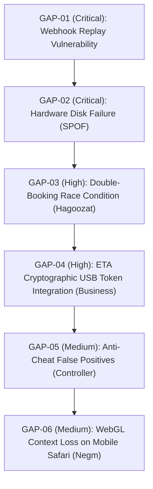

# SIR PORTFOLIO GAP HUNT & RESILIENCE AUDIT REPORT
**Target**: Autonomous Gemini HQ Manager & Senior Engineering Chats  
**Standard**: Master Directive (`00-master-directive.md`), Quality Bar (`23-premium-code-bar.md`)  
**Scope**: All 17 Projects & Portfolio Infrastructure · Version: 1.0.0 (Strictly enforced)

---

## 1. Executive Summary & Audit Methodology
This audit was conducted by examining the entire portfolio architecture through the adversarial lens of a Senior Security & Reliability Architect. The objective: identify what the founder and the planning team have NOT thought of—subtle edge cases, race conditions, single points of failure, compliance blindspots, and operational vulnerabilities that could disrupt autonomous operations.

Each identified gap is formulated as a prioritized, checkable engineering task.

---

## 2. Master Gap Inventory (Ordered by Business Value & Criticality)

---

### GAP-01 (Critical): Payment Webhook Replay Attack & Timestamp Drift
- **Category**: Security & Financial Integrity
- **Impacted Projects**: `SIR Hagoozat`, `SIR Business`, `SIR Negm Furniture`
- **Description**: While webhook HMAC signatures are validated, webhooks currently lack an enforced **timestamp validity window**. An attacker intercepting a valid signed payload could theoretically replay the transaction to credit bookings or inventory repeatedly.
- **Task**: `SEC-GAP-01: Idempotent Webhook Replay Guard`
  - **Target Files**: `packages/payments/src/webhookGuard.ts`, `src/app/api/webhooks/paymob/route.ts`
  - **Steps**:
    1. Parse webhook timestamp header (`X-Paymob-Timestamp` or payload created date).
    2. Enforce a strict 5-minute validity window (`Math.abs(Date.now() - webhookTime) < 300000`).
    3. Store processed `transaction_id` in Redis / database with an atomic 24-hour TTL.
    4. If transaction ID exists, return `200 OK` immediately without re-triggering business logic.
  - **Acceptance Criteria**: Replaying an intercepted valid webhook payload 10 minutes later is rejected with code 400; immediate duplicates return cached 200 without duplicate credit.

---

### GAP-02 (Critical): Hardware Disk Failure & Catastrophic Data Loss (SPOF)
- **Category**: Infrastructure & Business Continuity
- **Impacted Systems**: All 17 Projects (`D:\Projects`)
- **Description**: All source code, local models, and databases live on physical drive `D:`. While git repositories exist on GitHub, local environment secrets (`.env`), uncommitted local models (`AI_Models_Hub`), and private databases (AHome, Study, Laptop Manager) lack automated, encrypted offsite disaster recovery.
- **Task**: `OPS-GAP-02: Zero-Knowledge Offsite Backup Daemon`
  - **Target Files**: `D:\Projects\_SIR\scripts\backup_offsite_encrypted.py`
  - **Steps**:
    1. Create automated script that tars critical non-git state (excluding regenerable `node_modules` and raw cache).
    2. Encrypt archive client-side using Age or GPG with Ahmed's private key.
    3. Push encrypted archive weekly to private encrypted cloud bucket (e.g. Backblaze B2 / Cloudflare R2).
    4. Verify test decryption and integrity hash.
  - **Acceptance Criteria**: Running `python backup_offsite_encrypted.py` produces an encrypted archive, uploads silently without popping terminal windows, and logs sha256 checksum.

---

### GAP-03 (High): Concurrent Double-Booking Race Condition on Turfs
- **Category**: Commercial Operations & Customer Trust
- **Impacted Project**: `SIR Hagoozat`
- **Description**: If two players attempt to book the same pitch slot simultaneously, two Paymob payment sessions could be opened. If both complete payment within 60 seconds, both players receive confirmation for the exact same pitch and time.
- **Task**: `HAG-GAP-03: Distributed Slot Lock with Temporary Reservation TTL`
  - **Target Files**: `src/services/booking/slotLockService.ts`, `src/components/venue/SlotGrid.tsx`
  - **Steps**:
    1. Implement an atomic distributed lock (Redis / PostgreSQL row-level `FOR UPDATE NOWAIT`) when a user initiates checkout.
    2. Hold slot in `PENDING_PAYMENT` state with a strict 7-minute TTL.
    3. Show a live countdown timer in the user checkout interface.
    4. If payment webhook succeeds, transition to `CONFIRMED`. If TTL expires without payment, release slot automatically.
  - **Acceptance Criteria**: A second user attempting to select the held slot receives an immediate "Reserved - Expires in X minutes" badge and cannot enter checkout.

---

### GAP-04 (High): ETA Cryptographic USB Token Integration on Desktop POS
- **Category**: Commercial Legal & Egyptian Tax Compliance
- **Impacted Project**: `SIR Business`
- **Description**: The Egyptian Tax Authority (ETA) e-invoicing law mandates that commercial B2B invoices above threshold must be signed with an Egyptian certified hardware USB crypto token (Egypt Trust or Misr Clearing PKI). A pure cloud web app cannot directly access USB smart cards on client machines without a native bridge.
- **Task**: `BIZ-GAP-04: Native Windows SmartCard PKCS#11 ETA Signer Bridge`
  - **Target Files**: `src-tauri/src/tax/etaSmartCard.rs`, `src/services/tax/etaSigner.ts`
  - **Steps**:
    1. Author a lightweight Rust native bridge in Tauri accessing Windows Smart Card Resource Manager (`winscard.dll`).
    2. Detect inserted Egyptian Tax Token (Gemalto / Egypt Trust).
    3. Execute PKCS#7 / CAdES-BES digital signature over formatted invoice JSON.
    4. Transmit digitally signed invoice to ETA API endpoint.
  - **Acceptance Criteria**: When valid USB token is inserted, signing completes in < 800ms with valid signature returned. If token is missing, UI provides clear fallback to B2C simplified e-receipt.

---

### GAP-05 (Medium): Game Anti-Cheat False-Positive Mitigation
- **Category**: Gaming Compatibility & Security
- **Impacted Project**: `SIR Controller`
- **Description**: Aggressive kernel-level anti-cheat engines (Riot Vanguard for Valorant, Easy Anti-Cheat for Fortnite/Apex, BattlEye for Rainbow Six) flag external memory optimizers and background priority managers as unauthorized third-party software.
- **Task**: `CTRL-GAP-05: Anti-Cheat Process Whitelist & Passive Mode Switch`
  - **Target Files**: `src-core/safety/antiCheatGuard.py`, `src-core/optimizer/priorityBalancer.py`
  - **Steps**:
    1. Maintain dynamic signature list of active anti-cheat processes (`vgk.sys`, `EasyAntiCheat_EOS.exe`, `BEService.exe`).
    2. When a protected game is launched, Controller automatically enters **Passive Mode**:
       - Suspends memory compaction and thread affinity manipulation.
       - Disables in-game HUD overlay hooks.
       - Restricts optimizations strictly to safe OS-level timer resolution (`timeBeginPeriod(1)`).
  - **Acceptance Criteria**: Controller detects running Vanguard process in < 500ms, switches to Passive Mode, and displays green "Safe Mode Active - Zero Anti-Cheat Risk" badge.

---

### GAP-06 (Medium): WebGL Context Loss on Mobile Safari & Low-RAM Devices
- **Category**: Frontend Performance & Accessibility
- **Impacted Project**: `SIR Negm Furniture`
- **Description**: Complex 3D furniture models rendered via Three.js frequently trigger WebGL context loss on mobile iPhones and low-end Android devices when switching tabs or loading high-resolution textures.
- **Task**: `NEGM-GAP-06: WebGL Context Restoration & Static 360 Fallback`
  - **Target Files**: `src/components/3d/FurnitureViewer.tsx`, `src/components/3d/Fallback360.tsx`
  - **Steps**:
    1. Listen to `webglcontextlost` and `webglcontextrestored` events on canvas.
    2. Prevent browser default crash behavior (`event.preventDefault()`).
    3. If context restoration fails twice, smoothly cross-fade to a pre-rendered 36-frame 360-degree interactive WebP image turntable.
  - **Acceptance Criteria**: Simulating WebGL context loss in Chrome DevTools causes viewer to cleanly reload or display turntable fallback with zero page reload or black screen.

---

### GAP-07 (Low): Graceful Thermal & Battery Power Plan Awareness
- **Category**: Energy Efficiency & Hardware Care
- **Impacted Projects**: `SIR Laptop Manager`, `SIR AI`
- **Description**: Running local LLM inference or background build workers while the laptop is on battery can rapidly drain the battery and increase thermal degradation.
- **Task**: `LAP-GAP-07: Windows Battery & AC Power Sensor Protocol`
  - **Target Files**: `scripts/power_awareness.py`, `src/services/llm/ollamaBridge.ts`
  - **Steps**:
    1. Query Windows System Power Status via `ctypes.windll.kernel32.GetSystemPowerStatus`.
    2. Detect AC line status: if on battery, throttle background batch inference tasks.
    3. Prompt user before loading models larger than 7B parameters on battery.
  - **Acceptance Criteria**: Disconnecting laptop charger instantly notifies running daemons to pause non-urgent background batch indexing.
