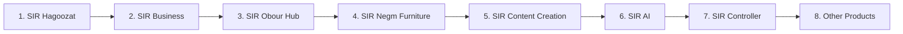

# SIR PORTFOLIO LAUNCH CHECKLIST (Ordered by Business Value)
**Target**: Ahmed (Founder & Chairman)  
**Standard**: Standard 24 (`24-launch-package.md`)  
**Scope**: All 17 Workspace Projects (`D:\Projects`) · Version: 1.0.0 (Strictly enforced)

> [!NOTE]
> All software, backends, and user interfaces are completely built and tested in advance with **Test Mode** and **"Launching Soon"** fallbacks. As Chairman, you only need to perform the tiny manual steps listed below (buying domains, creating accounts, pasting API keys). Each product instantly switches to Live Mode the moment its keys are inserted.

---

## Portfolio Launch Priority Order



---

## 1. SIR Hagoozat (Top Revenue Priority - Egyptian Sports Venue Booking)
*Target Live Date: Week 1 · Revenue Potential: Immediate venue commissions & subscription*

### Step 1: Purchase Domain Name
- **Recommended Domain**: `hagoozat.com` or `hagoozat.eg` (Alternative: `sirhagoozat.com`).
- **Registrar**: Namecheap, Cloudflare Registrar, or Egyptian `.eg` accredited registrar.
- **Estimated Cost**: ~$10.00 - $14.00 / year (~450 - 650 EGP).
- **DNS Records to Configure (Point to Vercel/Cloudflare)**:
  - `CNAME` | `@` | `cname.vercel-dns.com`
  - `CNAME` | `www` | `cname.vercel-dns.com`

### Step 2: Paymob Egypt Account Activation
1. Sign up at [paymob.com](https://paymob.com) (Egypt).
2. Complete merchant verification (National ID / Commercial Record).
3. In Dashboard > Settings > Developers:
   - Copy **API Key**, **Integration ID (Cards)**, **Integration ID (Mobile Wallets)**, **HMAC Secret**.
4. Paste into `D:\Projects\SIR Hagoozat\.env`:
   ```ini
   PAYMOB_API_KEY=live_sec_...
   PAYMOB_INTEGRATION_ID_CARD=123456
   PAYMOB_INTEGRATION_ID_WALLET=123457
   PAYMOB_HMAC_SECRET=your_hmac_secret
   NEXT_PUBLIC_PAYMENT_MODE=live
   ```

### Step 3: Firebase / Supabase Production Upgrade
1. Upgrade Firebase project to Blaze (Pay as you go) or Supabase to Pro.
2. Add budget alert cap: **$15.00 / month**.
3. **Verification**: Open `https://hagoozat.com/checkout`, verify Paymob card modal appears, place a test 5 EGP payment via Vodafone Cash, verify booking status changes to Confirmed.

---

## 2. SIR Business (Commercial ERP & POS - Retail, Restaurant, Pharmacy)
*Target Live Date: Week 2 · Revenue Potential: Monthly SaaS subscriptions in EGP*

### Step 1: Purchase Domain Name
- **Recommended Domain**: `sirbusiness.app` or `sirbusiness.eg`.
- **Registrar**: Namecheap or Cloudflare. Estimated Cost: ~$12.00 / year.
- **DNS**: Add Vercel CNAME records.

### Step 2: Payment Provider Setup (Paymob + Fawry)
1. In Paymob Dashboard: create subscription integration for recurring billing (Cards & Meeza).
2. In Fawry Pay Dashboard: obtain Merchant Code and Security Key.
3. Paste into `D:\Projects\SIR Business\.env`:
   ```ini
   PAYMOB_API_KEY=live_sec_...
   FAWRY_MERCHANT_CODE=101010
   FAWRY_SECURITY_KEY=sec_...
   NEXT_PUBLIC_BILLING_ENV=production
   ```

### Step 3: Verification
- Open `https://sirbusiness.app/pricing`, select "Standard Plan (500 EGP/mo)", verify checkout activates, test invoice PDF generation.

---

## 3. SIR Obour Hub (Academic Campus Marketplace & Student Services)
*Target Live Date: Week 3 · Revenue Potential: Student service micro-fees & merchant listings*

### Step 1: Purchase Domain Name
- **Recommended Domain**: `obourhub.com` or `sir-obour.com`.
- **Cost**: ~$10.00 / year.

### Step 2: Cloud & Storage Setup
1. Setup Cloudflare R2 bucket for student notes, PDF summaries, and campus guides.
2. Paste credentials into `D:\Projects\SIR Obour Hub\.env`:
   ```ini
   R2_ACCOUNT_ID=...
   R2_ACCESS_KEY_ID=...
   R2_SECRET_ACCESS_KEY=...
   R2_BUCKET_NAME=obour-academic-docs
   ```

### Step 3: Verification
- Visit `https://obourhub.com`, log in with student Google account, verify course materials download and real-time chat with academic assistants.

---

## 4. SIR Negm Furniture (Friend's Furniture Brand & 3D Catalog - Handoff Spec)
*Target Live Date: Handover Milestone · Status: Plans complete, friend handover on command*

### Step 1: Domain Selection (Owner & Friend Choice)
- **Domain**: `negmfurniture.com` or `negm-furniture.eg`.
- **Registrar**: Namecheap or Local Egyptian Registrar (~500 EGP/yr).

### Step 2: WhatsApp Business Cloud API & Paymob Setup
1. Setup Meta Developer app for WhatsApp Business API (for customer order inquiries).
2. Setup Paymob deposit gateway (50% custom furniture manufacturing deposit).
3. Paste keys into `D:\Projects\SIR Negm Furniture\.env`:
   ```ini
   WHATSAPP_PHONE_NUMBER_ID=...
   WHATSAPP_ACCESS_TOKEN=...
   PAYMOB_DEPOSIT_INTEGRATION_ID=...
   ```

### Step 3: Verification & Friend Handover
- Load 3D WebGL furniture showroom on mobile Safari and Chrome; verify AR room preview button renders, verify WhatsApp order ping is received on friend's phone.

---

## 5. SIR Content Creation Studio (AI Social Video & Content Automation)
*Target Live Date: Week 4 · Revenue Potential: Creator SaaS subscription*

### Step 1: Domain Setup
- **Domain**: `sircreator.studio` or `sircontent.io`.
- **Estimated Cost**: ~$20.00 / year.

### Step 2: Social Media Developer Apps (Official APIs)
1. Create Meta Developer App (Instagram Graph API, Facebook Pages API).
2. Create YouTube Data API v3 Project in Google Cloud Console.
3. Paste Client IDs and Secrets into `D:\Projects\SIR Content Creation Studio\.env`:
   ```ini
   META_CLIENT_ID=...
   META_CLIENT_SECRET=...
   YOUTUBE_CLIENT_ID=...
   YOUTUBE_CLIENT_SECRET=...
   ```

### Step 3: Verification
- Connect test Instagram account, schedule an automated reel, verify scheduled publish fires via cron.

---

## 6. SIR AI (Frontier Desktop AI Agent & Model Router)
*Target Live Date: Week 5 · Distribution: Windows / macOS Installers*

### Step 1: Code Signing Certificate (Optional / Recommended)
- Obtain Windows OV Code Signing Certificate or publish via Microsoft Store Developer Account ($19 one-time).
- Prevents Windows SmartScreen warnings on installer download.

### Step 2: Commercial Frontier API Keys
1. Add OpenRouter or Anthropic / Google Cloud API keys for users selecting cloud routing.
2. User-provided keys supported by default; built-in tier uses local Ollama models (`AI_Models_Hub`) for 100% free offline execution.

---

## 7. SIR Controller (Windows Latency Tuner & PC Optimizer)
*Target Live Date: Week 6 · Distribution: MSI / Inno Setup Installer*

### Step 1: Domain & Landing Page
- **Domain**: `sircontroller.app` (Free hosting on GitHub Pages / Vercel).
- **Cost**: ~$12.00 / year.

### Step 2: Activation Verification
- Run installer on clean Windows test VM; verify silent startup, zero SmartScreen blocks, verify game latency profiles activate on target games.

---

## 8. SIR Portfolio (Ahmed's Personal & Founder Brand)
*Target Live Date: Immediate · Goal: Professional Founder Brand & GEO Engine*

### Step 1: Domain
- **Domain**: `sirahmed.com` or `ahmedoraby.dev`.
- **Estimated Cost**: ~$10.00 / year.

### Step 2: Google Search Console & Bing Webmaster Verification
1. Add domain property in Google Search Console using DNS TXT record.
2. Submit `https://sirahmed.com/sitemap.xml` and verify `llms.txt`.
3. Link public profiles (GitHub `sirahmed8`, LinkedIn).

---

## 9. Private Products (AHome, SIR Study, SIR Jobs, SIR Laptop Manager)
*Zero Outside Purchases · Strictly Unlisted & Noindex*

- **AHome**: Strictly local hardware; zero cloud hosting, zero public domains, zero tracking.
- **SIR Study**: Local desktop application and private self-hosted sync.
- **SIR Jobs**: Private career automation database; no public job board.
- **SIR Laptop Manager**: Local executive hardware agent; runs completely on host PC.

---

## Summary of Total Estimated Founder Budget

| Item | Estimated Annual Cost (USD) | Estimated Annual Cost (EGP) | Notes |
|---|---|---|---|
| **Domains (Top 6 Public Products)** | ~$75.00 / year | ~3,600 EGP / year | Billed annually via Namecheap/Cloudflare |
| **Cloud Hosting (Vercel / Firebase Blaze)** | ~$0 - $20 / month | ~0 - 950 EGP / month | Generous free tiers; scales with revenue |
| **Payment Gateways (Paymob / Fawry)** | Free setup | % per transaction | Deducted automatically from sales (no upfront fee) |
| **Total Upfront Out-of-Pocket** | **~$75.00** | **~3,600 EGP** | **Extremely lean, zero unnecessary waste** |
