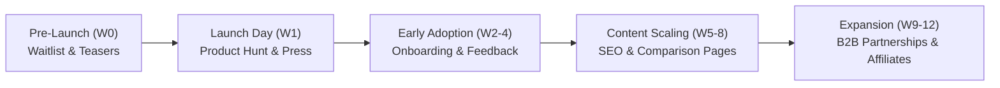

# SIR PORTFOLIO MARKETING & GROWTH MASTER PLAN
**Target**: Autonomous Gemini HQ Manager & Marketing Daemons  
**Standard**: Standards 26 (`26-autonomous-operations.md`) & 27 (`27-visibility.md`)  
**Scope**: All Public Commercial Products · Version: 1.0.0 (Strictly enforced)

---

## 1. Executive Positioning & Value Propositions

| Product | Arabic Tagline | English Value Proposition | Primary Audience (ICP) |
|---|---|---|---|
| **SIR Hagoozat** | احجز ملعبك في ثواني بضغطة واحدة | Real-time sports venue booking with instant split payments and WhatsApp confirmation | Egyptian amateur football/padel players & venue managers |
| **SIR Business** | نظام سحابي متكامل لنقاط البيع وإدارة محلك وصيدليتك بسعر عادل بالجنيه | All-in-one POS, inventory & ETA e-invoicing for retail, restaurants & pharmacies | Egyptian and Arab SME retail owners & shop managers |
| **SIR Obour Hub** | مجتمع وخدمات العبور الأكاديمية في مكان واحد | Unified academic community, study hub & student marketplace | Obour Institutes & University students (15,000+ students) |
| **SIR Negm Furniture** | أثاث فاخر بتصميمات عصرية ومعاينة ثلاثية الأبعاد تفاعلية في غرفتك | Bespoke luxury furniture with interactive 3D WebGL room preview | Egyptian homeowners, interior designers & newlyweds |
| **SIR Content Studio** | إنتاج وأتمتة محتوى الفيديو والتواصل الاجتماعي بدقة فائقة | Autonomous video generation & scheduled multi-platform publishing | Content creators, digital marketing agencies, Arabic podcasters |
| **SIR Controller** | أقصى استجابة لجهازك وألعابك مع حماية كاملة للنظام | System latency optimization, FPS booster & game-ready profiler | PC gamers, competitive esports players, creative pros |
| **SIR AI** | وكيل ذكاء اصطناعي محلي فائق السرعة يحترم خصوصيتك بالكامل | Frontier local-first AI assistant running on private models | Developers, power users, privacy-conscious executives |
| **SIR Life** | نظام ذكي لبناء العادات والإنتاجية المتوازنة | Holistic habit tracker, personal health sync & routines | Health-conscious individuals, students, professionals |

---

## 2. 12-Week Master Launch Calendar (From Zero to Market Authority)

### Pre-Launch Phase (Weeks -2 to 0)
- **Waitlist Page**: Clean hero landing page with email capture and "Get Early Access" badge.
- **Foundational SEO**: Deploy `sitemap.xml`, `robots.txt`, and `llms.txt` to enable early indexing by Google, Bing, and AI answer engines.
- **Teaser Video Production**: 45-second high-resolution demo reels highlighting flagship features (e.g. 3D room preview in Negm Furniture, split payments in Hagoozat) created via Content Creation Studio.

### Launch Week (Week 1)
- **Day 1 (Tuesday 08:00 EST)**: Official launch on Product Hunt, Hacker News Show, and regional tech forums (e.g., r/Egypt, Egyptian Startups groups).
- **Day 2**: Press kit distribution to regional tech publications (Enterprise Egypt, Wamda, Arab News, Menabytes).
- **Day 3**: Social channel launch blitz across LinkedIn, X/Twitter, and Instagram via official APIs.
- **Day 4–7**: Monitor real user registrations, triage initial feedback, and ship daily iterative polish fixes.

### Early Adoption & Community Phase (Weeks 2 to 4)
- **Automated Email Activation**: Trigger onboarding email sequences to guide new users to their "Aha!" moment.
- **Referral Loop Activation**: Users earn 1 free month of Pro subscription for referring 3 active users.
- **Community Engagement**: Host live Q&A demos on YouTube and LinkedIn addressing top customer questions.

### SEO & Organic Content Expansion (Weeks 5 to 8)
- **Pillar Content Release**: Publish 3 authoritative guides per week addressing high-intent search queries (e.g. *"أفضل نظام كاشير في مصر"*, *"طريقة حجز ملاعب البادل"*).
- **Competitor Alternative Pages**: Deploy dedicated comparison pages (*"SIR Business vs Loyverse"*, *"SIR Hagoozat vs Bookafield"*).

### B2B Partnerships & Scaling (Weeks 9 to 12)
- **Field Outreach**: Directly onboard the top 20 football venues in Cairo/Giza for Hagoozat and top 30 retail shops in Obour/New Cairo for SIR Business.
- **Influencer & Academy Collaborations**: Partner with local Egyptian sports academies and student unions.

---

## 3. Social Media Distribution via Official APIs

All social marketing is executed programmatically through official platform APIs to ensure reliability and strict platform compliance:
- **Meta Graph API**: Publishes scheduled carousels, reels, and stories to Instagram and Facebook business pages.
- **YouTube Data API v3**: Uploads feature walkthroughs, YouTube Shorts, and changelog digests with full chapters and transcripts.
- **LinkedIn Marketing API**: Shares technical architecture deep dives, founder insights, and commercial milestones.

> [!CAUTION]
> **Brand Voice Guard Rails**:
> All social posts operate under the official product or brand name (e.g. "SIR Business Official"). Agents NEVER pose as Ahmed in conversational DMs or comments. Engagement bots, fake likes, and automated scraping of private social data are strictly banned.

---

## 4. Lifecycle Email Marketing Sequences

All automated emails use clean, responsive HTML templates with 1-click unsubscribe links and strict deliverability standards (SPF, DKIM, DMARC):

1. **Welcome Email (Trigger: Instant on Sign-Up)**:
   - Subject: *"أهلاً بك في [اسم المنتج] - خطوتك الأولى للبدء"*
   - Body: Warm welcome from the SIR team, 3-step quick start checklist, direct link to in-app assistant.
2. **Activation Prompt (Trigger: Day 2 if no primary action taken)**:
   - Subject: *"هل تحتاج مساعدة في إعداد [الميزة الرئيسية]؟"*
   - Body: 1-minute video walkthrough showing how easy it is to complete the first action.
3. **Power Feature Spotlight (Trigger: Day 7)**:
   - Subject: *"وفر 5 ساعات أسبوعياً مع ميزة [X]"*
   - Body: Case study demonstrating how existing users save time or increase revenue using the Pro tier.
4. **Inactive Win-Back (Trigger: Day 21 of inactivity)**:
   - Subject: *"افتقدناك في [اسم المنتج] - شاهد ما هو جديد"*
   - Body: Summary of recent improvements and a direct link to resume where they left off.

---

## 5. Official Press Kit & Digital PR Package

Every public repository maintains a public `/press` directory:
- **Brand Assets**: High-resolution SVG logos (dark and light modes), app icons (1024x1024 PNG), and brand color palette swatches.
- **Executive Factsheet**: 1-page PDF summarizing founding date, mission, leadership, technology stack, and verified metrics.
- **Screenshots & Media**: Lossless WebP mockups showcasing the application running on desktop, tablet, and mobile viewports.
- **Media Contact**: `press@sirahmed.com` (triage by autonomous manager; critical inquiries escalated to Chairman).
