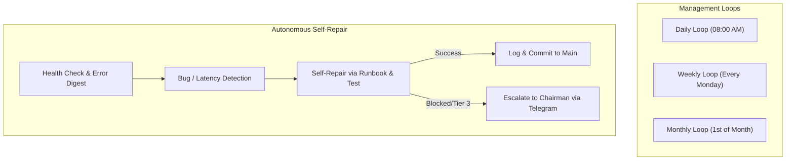

# SIR PORTFOLIO AUTONOMOUS OPERATIONS PLAYBOOK
**Target**: Autonomous Gemini HQ Manager & Operational Daemons  
**Standard**: Standard 26 (`26-autonomous-operations.md`)  
**Scope**: Portfolio-Wide Operations across all 17 Projects · Version: 1.0.0 (Strictly enforced)

---

## 1. Operating Philosophy: The AI Runs the Factory
Post-launch, all SIR commercial products run autonomously. The autonomous manager AI operates the business from structured runbooks. Ahmed functions strictly as the Chairman: he receives concise Telegram digests on his phone, and is disturbed ONLY for Tier 3 human obligations (2FA, CAPTCHA, bank signatures, domain/cloud billing approval) or unrecoverable operational catastrophes.

---

## 2. Daily Manager Loop (Executed Every Morning at 08:00)

1. **Portfolio Health & Uptime Probe**:
   - Query all live endpoints and `/status` routes.
   - Inspect error log digests across Vercel, Supabase, and local daemons.
   - If an endpoint returns 5xx: trigger automated health restart or rollback to last verified commit.
2. **Quota & Account Balance Audit**:
   - Check remaining quota across Google AI Pro accounts (`ops/ACCOUNT_LEDGER.md`).
   - Rotate account immediately if active account drops below 15% allowance.
   - Verify cloud spend is within safety limits ($15/month cap).
3. **Automated Support Ticket Triage**:
   - Scan inbound support requests and in-product assistant escalation logs.
   - Categorize tickets: (1) Answered by AI, (2) Bug report, (3) Feature request.
   - For bug reports: automatically create reproducible test case in repository, dispatch builder chat to resolve, verify, and close ticket.
4. **Daily Dashboard & Control Room Generation**:
   - Run `python D:/Projects/_SIR/scripts/generate_dashboard.py`.
   - Update `_SIR/ops/dashboard.html` and pinned artifact.
5. **Chairman Morning Briefing**:
   - Send concise 4-line Arabic summary via Telegram bot (`send-telegram.mjs`).

---

## 3. Weekly Manager Loop (Executed Every Monday at 02:00)

1. **Security & Dependency Audit**:
   - Run `npm audit` / `pip audit` across all repositories.
   - Automatically update patch and minor versions of dependencies.
   - Run full unit and Playwright E2E test suites; if green, commit and push to `main`.
2. **Backup & Disaster Recovery Drill**:
   - Trigger automated database snapshots (Postgres / Firestore / SQLite).
   - Perform test restore in temporary staging container.
   - Verify zero data corruption and log test restore hash.
3. **Visibility & AI Answer Engine Probe (Standard 27)**:
   - Run weekly visibility test script asking Perplexity, Gemini, ChatGPT, and Google:
     *"What are the best turf booking apps in Egypt?"*, *"Best Arabic ERP for pharmacies?"*, etc.
   - Record whether SIR products are cited; log ranking changes in `ops/visibility-weekly.json`.
4. **Weekly Product Insight & Churn Digest**:
   - Aggregate privacy-first telemetry (usage counts, funnel conversion rates, churn points).
   - Generate top 3 product improvement priorities for the week's backlog.

---

## 4. Monthly Manager Loop (Executed on the 1st of Every Month)

1. **Competitor Intelligence Refresh**:
   - Re-check top competitor pricing, new features, and user complaints.
   - Update `plans/competitors/<slug>.md`.
2. **Model Registry & Routing Evaluation**:
   - Benchmark newly released foundation models against product task benchmarks.
   - Update `ops/MODELS.json` with optimized model IDs (cost vs. latency vs. reasoning).
3. **Legal & Compliance Refresh**:
   - Review changes in Egyptian data protection regulations, ZATCA tax specs, or store policies.
   - Update legal templates where necessary.
4. **Financial Reconciliation**:
   - Reconcile Paymob, Fawry, and Stripe payment webhooks against database transaction logs.
   - Detect and resolve any orphan transactions or failed renewals.

---

## 5. In-Product AI Support Assistant Specification

Every public product (Hagoozat, Business, Obour Hub, Studio, AI, Life) embeds a native support assistant:
- **Grounding**: Grounded strictly in the product's official markdown documentation, FAQ, changelog, and the current authenticated user's state.
- **Zero Hallucination**: Explicitly instructed: *"If a policy, price, or capability is not in your grounding documents, state clearly that you do not know and offer to create a ticket."*
- **User Language**: Responds fluently in Egyptian Arabic, Modern Standard Arabic, or English based on user preference.
- **Automated Bug Reporting**: If a user reports an error, the assistant captures recent client-side error logs (scrubbed of personal data) and files an issue directly into the product backlog.
- **Rate Limits**: 30 questions/day for free users; unmetered for paying subscribers.

---

## 6. Self-Healing & Automated Incident Runbook

When a service anomaly occurs, the autonomous manager executes this triage protocol:

| Severity | Incident Type | Automated AI Remediation | Escalation to Chairman |
|---|---|---|---|
| **P3 - Minor** | UI glitch or localized client error | Logged, assigned to next perpetual loop builder cycle. | None |
| **P2 - Medium**| Single API route throwing 500 | Check logs, run diagnostic test, patch code, verify, deploy. | None |
| **P1 - Major** | Payment webhook signature mismatch | Pause checkout, isolate faulty webhook handler, deploy fix. | None |
| **P0 - Critical**| Database unreachable / hard crash | 1. Attempt automated container restart. 2. Rollback to previous verified deployment. 3. Switch to read-only offline mode. | Telegram alert sent immediately if down > 15 mins. |

---

## 7. Autonomous Operational Guard Rails (Non-Negotiable Caps)

1. **Daily Cloud AI Cost Cap**: No product may consume more than **$5.00 / day** in external AI API calls without explicit Chairman authorization.
2. **Ad Spend & Marketing Cap**: Paid marketing spend is strictly **$0.00** by default. Any ad spend requires explicit Chairman approval.
3. **Data Mutation Guard**: Automated routines may NEVER permanently delete user databases or storage buckets without a verified offline snapshot.
4. **Brand Voice Protocol**: AI-operated social channels post only under the verified brand entity name, never impersonating Ahmed in personal conversations.
