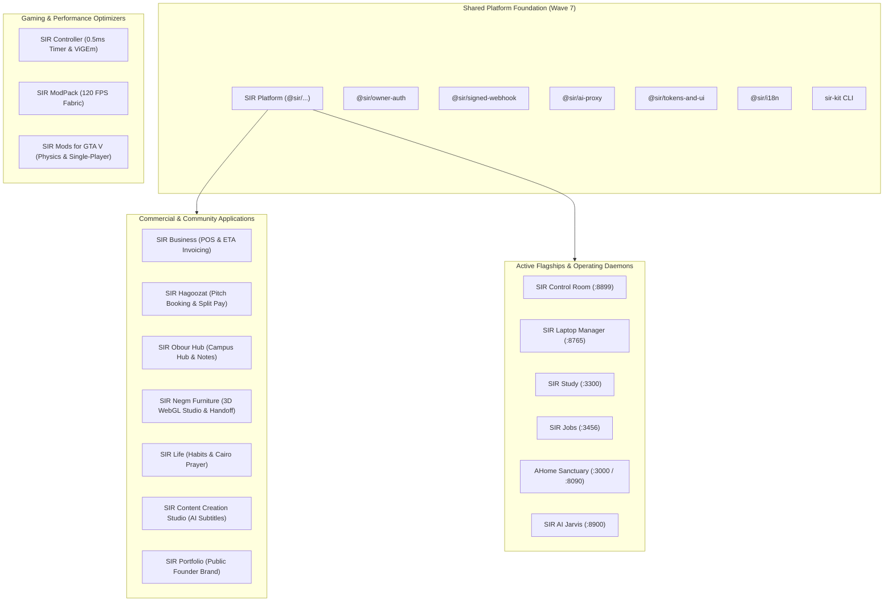

# PORTFOLIO LINKS: Inter-Project Topology & Shared Platform Matrix
**Standard**: SIR Workspace Architecture Specification & Standards 23–27  
**Scope**: All 17 Workspace Projects (`D:\Projects`)  
**Network Mesh**: Local Loopback (`127.0.0.1`) & Private WireGuard Tailnet (`ahmed.tail9e9aa7.ts.net`)  
**Version**: 1.0.0 (Strictly enforced)

---

## 1. High-Level Ecosystem Topology

---

## 2. Port & Service Allocation Map

| Project | Local Port | Health Check Route | Protocol | Data Boundary | Primary Dependencies |
|---|---|---|---|---|---|
| **AHome** | `:3000` / `:8090` | `http://127.0.0.1:8090/health` | HTTP / WS | **Air-gapped (Private)** | Local Zigbee Hub, `AI_Models_Hub` |
| **SIR Laptop Manager**| `:8765` | `http://127.0.0.1:8765/api/status` | HTTP / IPC | Local Host Hardware | Windows API, Task Scheduler, Tailscale |
| **SIR Control Room** | `:8899` | `http://127.0.0.1:8899/api/health` | HTTP / SSE | Headquarters Ops | Telegram Bot, Git CLI, Antigravity |
| **SIR Study** | `:3300` | `http://127.0.0.1:3300/healthz` | HTTP | Private Local Desk | Local KaTeX, Local SQLite |
| **SIR Jobs** | `:3456` | `http://127.0.0.1:3456/health` | HTTP | Private Local Desk | Local ATS Parser, Ollama Bridge |
| **SIR AI** | `:8900` | `http://127.0.0.1:8900/api/v1/ping` | HTTP / WS | Hybrid (Local + Cloud) | `AI_Models_Hub`, OpenRouter |
| **SIR Hagoozat** | `:4000` | `http://127.0.0.1:4000/api/health` | HTTP / WS | Commercial Public | Paymob, WhatsApp Cloud API, Supabase |
| **SIR Business** | `:4200` | `http://127.0.0.1:4200/api/v1/status`| HTTP | Commercial Public | ETA e-Invoicing, Paymob, Fawry |
| **SIR Obour Hub** | `:4300` | `http://127.0.0.1:4300/api/health` | HTTP | Campus Community | Cloudflare R2, Supabase |
| **SIR Negm Furniture**| `:4400` | `http://127.0.0.1:4400/api/health` | HTTP | Commercial Handoff | Three.js WebGL, Paymob, WhatsApp API |
| **SIR Content Studio**| `:4500` | `http://127.0.0.1:4500/api/status` | HTTP / IPC | Creator SaaS | Local FFmpeg, Meta Graph API, YouTube |
| **SIR Life** | `:4600` | `http://127.0.0.1:4600/api/health` | HTTP | Personal / Public | Cairo Prayer Calculator, Local IndexedDB |
| **SIR Controller** | `:5050` | `http://127.0.0.1:5050/api/health` | HTTP / IPC | Local PC Optimizer | Windows Multimedia Timer, ViGEmBus |
| **SIR ModPack** | Desktop | IPC / Local Sockets | Local | Gaming Desktop | Fabric API, Java Runtime |
| **SIR Mods for GTA V**| Desktop | File System Hooks | Local | Gaming Desktop | ScriptHookV, OpenIV Archive |
| **SIR Portfolio** | `:3100` | `http://127.0.0.1:3100/api/health` | HTTP | Public Founder Showcase | Next.js App Router, GEO `llms.txt` |
| **SIR Platform** | Monorepo | Monorepo package build | NPM / Pnpm | Shared Library | Tailwind CSS v4, Framer Motion Springs |

---

## 3. Inter-Service Communication & Shared Package Matrix

### 3.1 `@sir/owner-auth`
- Shared authentication middleware verifying HMAC signatures for inter-service communication across local ports.
- Prevents cross-site request forgery when local web apps talk to background daemon ports (`:8765`, `:8899`, `:8900`).

### 3.2 `@sir/tokens-and-ui` & `@sir/springs`
- Houses the Dynamic Island spring curves (`cubic-bezier(0.16, 1, 0.3, 1)`), active-only tab bar logic, and semantic color palette (Sapphire, Emerald, Crimson, Slate; **zero yellow**).
- Reusable across Next.js, Vite, and Tauri frontends.

### 3.3 `@sir/payments`
- Universal payment checkout modal supporting Paymob (Cards, Mobile Wallets, Meeza) and Fawry with automated "Launching Soon" fallback on missing live keys.

---

## 4. Master Document & Plan Index

| Document | Path | Purpose |
|---|---|---|
| **Instructions for Antigravity** | `_SIR/plans/INSTRUCTIONS_FOR_ANTIGRAVITY.md` | Standing orders for Gemini chats: planning, coding, test, review |
| **Instructions for Manager** | `_SIR/plans/INSTRUCTIONS_FOR_MANAGER.md` | Autonomous manager takeover: daily loop, dispatching, quota rotation |
| **Coding Standards** | `_SIR/plans/CODING_STANDARDS.md` | Stack choices, folder layout, spring CSS/JS code, RTL rules |
| **Chat Prompt Templates** | `_SIR/plans/CHAT_PROMPT_TEMPLATES.md` | Ready-to-paste prompts for builders, auditors, and reviews |
| **Quota & Model Rotation** | `_SIR/plans/QUOTA_AND_MODELS.md` | Hierarchy of models and accounts, automated 15% threshold rotation |
| **Launch Checklist All** | `_SIR/plans/LAUNCH_CHECKLIST_ALL.md` | Value-ordered owner activation checklist with exact steps |
| **Market Grade Checklist** | `_SIR/plans/MARKET_GRADE_CHECKLIST.md` | Cross-project compliance matrix against Standard 25 |
| **Operations Playbook** | `_SIR/plans/OPERATIONS_PLAYBOOK_ALL.md` | Portfolio-level daily, weekly, and monthly manager operations |
| **Marketing Plan** | `_SIR/plans/MARKETING_PLAN_ALL.md` | 12-week launch calendar, positioning, official social APIs |
| **Visibility Plan** | `_SIR/plans/VISIBILITY_PLAN_ALL.md` | SEO, GEO `llms.txt`, AEO, ASO, and weekly check script |
| **Master Task Backlog** | `_SIR/plans/TASK_BACKLOG_ALL.md` | Consolidated next 25 tasks per project with dependencies |
| **Gap Hunt Report** | `_SIR/plans/GAP_REPORT.md` | Adversarial audit of portfolio single points of failure & blindspots |
