# PORTFOLIO LINKS: Inter-Project Topology & Shared Platform Matrix
**Standard**: SIR Workspace Architecture Specification  
**Scope**: All 17 Workspace Projects (`D:\Projects`)  
**Network Mesh**: Local Loopback (`127.0.0.1`) & Private WireGuard Tailnet (`ahmed.tail9e9aa7.ts.net`)  
**Version**: 1.0.0 (Strictly enforced)

---

## 1. High-Level Ecosystem Topology

```mermaid
graph TD
    subgraph CoreFoundation["Shared Platform Foundation (Wave 7)"]
        Platform["SIR Platform (@sir/...)"]
        AuthLib["@sir/owner-auth"]
        HookLib["@sir/signed-webhook"]
        ProxyLib["@sir/ai-proxy"]
        UILib["@sir/tokens-and-ui"]
        I18nLib["@sir/i18n"]
        SirKit["sir-kit CLI"]
    end

    subgraph Flagships["Active Flagships & Operating Daemons"]
        HQ["SIR Control Room (:8899)"]
        Laptop["SIR Laptop Manager (:8765)"]
        Study["SIR Study (:3300)"]
        Jobs["SIR Jobs (:3456)"]
        AHome["AHome Sanctuary (:3000 / :8090)"]
        AI["SIR AI Jarvis (:8900)"]
    end

    subgraph Products["Commercial & Community Applications"]
        Business["SIR Business (POS & Inventory)"]
        Hagoozat["SIR Hagoozat (Pitch Booking & 5v5)"]
        Obour["SIR Obour Hub (Campus Timetable)"]
        Life["SIR Life (Habits & Cairo Prayer)"]
        Studio["SIR Content Creation Studio (ByteVibeHQ)"]
        Portfolio["SIR Portfolio (Public Wall)"]
    end

    subgraph Gaming["Gaming & Performance Optimizers"]
        Controller["SIR Controller (0.5ms Timer & ViGEm)"]
        ModPack["SIR ModPack (120 FPS Fabric)"]
        GTAMods["SIR Mods for GTA V (Physics & Single-Player)"]
    end

    subgraph Isolated["Isolated & Frozen"]
        Negm["SIR Negm Furniture (FROZEN - Handoff Pack)"]
    end

    %% Dependencies & Service Ingestion
    Platform --> Business
    Platform --> Hagoozat
    Platform --> Obour
    Platform --> Life
    Platform --> Studio
    Platform --> Portfolio

    Laptop -->|Game Mode Relief| AI
    Laptop -->|Game Mode Relief| Studio
    Laptop -->|Game Mode Relief| Controller

    AI -->|Local LLM Fallback Proxy| Jobs
    AI -->|Voice Synthesis| Studio
    AI -->|Voice Assistant| Laptop

    Study -->|Curriculum Data & Links| Obour
    Jobs -->|Verified Portfolio Snippets & CV| Portfolio
    HQ -->|Live Telemetry & State| Portfolio

    Controller -->|Input Remapping| ModPack
    Controller -->|Gamepad Telemetry| GTAMods
    Controller -->|Timer 0.5ms Tuning| Laptop

    %% AHome Sacred Isolation
    AHome -.-x|SACRED ISOLATION - Zero External Ingress| Platform
    AHome -.-x|SACRED ISOLATION - Zero Cloud Leaks| AI
```



---

## 2. Port & Daemon Registry (Single Source of Truth)

| Port | Protocol | Owning Project | Daemon Launcher | Ingress Security Gate |
| :---: | :---: | :--- | :--- | :--- |
| **3000** | HTTP / WS | **AHome** (Web) | `dev-start.vbs` (Next.js) | Loopback / Tailnet only (Zero Public Ingress) |
| **3300** | HTTP | **SIR Study** | `scripts/dev-start.vbs` (`pythonw.exe`) | Loopback / `Tailscale-User-Login: a7medorabe7@gmail.com` |
| **3456** | HTTP / SSE | **SIR Jobs** | `scripts/dev-start.vbs` (`node.exe`) | Loopback / `Tailscale-User-Login: a7medorabe7@gmail.com` |
| **8090** | HTTP / WS | **AHome** (Local Core) | `scripts/core-restart.ps1` (FastAPI) | Loopback only (`127.0.0.1:8090`, DPAPI AES-256 Vault) |
| **8765** | HTTP / REST | **SIR Laptop Manager** | `scripts/dev-start.vbs` (`pythonw.exe`) | Loopback / `Tailscale-User-Login: a7medorabe7@gmail.com` |
| **8899** | HTTP / WS | **SIR Control Room** | `scripts/run-refresh-hidden.vbs` | Loopback / `Tailscale-User-Login` (Sub-ms ETag 304) |
| **8900** | HTTP / WS | **SIR AI** (Jarvis) | `scripts/dev-start.vbs` (FastAPI) | Loopback / `Tailscale-User-Login: a7medorabe7@gmail.com` |
| **8905** | UDP | **SIR Mods for GTA V** | `plugins/sir_telemetry.asi` | Localhost loopback UDP broadcast for telemetry |

---

## 3. Cross-Project Provider & Consumer Matrix

| Project | What It Provides to Others | What It Consumes from Others |
| :--- | :--- | :--- |
| **AHome** | **Nothing** (Sacred privacy boundary; zero couple data ever leaves local vault). | Consumes nothing from outside; completely isolated and self-contained. |
| **SIR Laptop Manager** | Hardware telemetry, Game Mode process suspension events, cross-IDE agent config sync, reversible quarantine storage. | Consumes 0.5ms timer resolution from `SIR Controller`; voice commands from `SIR AI`. |
| **SIR Study** | Academic curriculum structures, cram sheets, and subject mastery maps. | Consumes campus timetable context and exam dates from `SIR Obour Hub`. |
| **SIR Jobs** | Real cash income engine, verified developer portfolio snippets, agency-grade A4 CV PDF generator. | Consumes AI fit scoring models from `SIR AI`; git health metrics from `SIR Control Room`. |
| **SIR Control Room** | Portfolio-wide real-time intelligence, dirty git tracking, CI gate monitoring, and attention queue. | Consumes status reports and request ledgers from all 16 projects. |
| **SIR AI** | Central local LLM gateway (`AI_Models_Hub`), speech-to-text (Whisper), neural TTS (Piper), and Telegram bot infrastructure. | Consumes process lifecycle APIs from `SIR Laptop Manager`; project metadata from `_SIR`. |
| **SIR Business** | Multi-vertical POS transaction processing, thermal receipt ESC/POS engine, and inventory models. | Consumes `@sir/owner-auth` and `@sir/signed-webhook` from `SIR Platform`. |
| **SIR Hagoozat** | Amateur sports tournament engine, pitch scheduling state machine, and player matchmaking. | Consumes `@sir/signed-webhook` and `@sir/tokens-and-ui` from `SIR Platform`. |
| **SIR Obour Hub** | Campus timetable, professor directory, lecture hall locator, and GPA simulation engine. | Consumes study guides from `SIR Study`; design tokens from `SIR Platform`. |
| **SIR Content Creation Studio** | Programmatic FFmpeg video rendering, kinetic subtitles, and multi-channel social posting. | Consumes speech synthesis from `SIR AI`; release logs from `_SIR`. |
| **SIR Controller** | 0.5ms high-precision Windows timer resolution, virtual Xbox 360 controller driver, and low-latency network tweaks. | Consumes Game Mode events from `SIR Laptop Manager`. |
| **SIR ModPack** | 120 FPS Fabric mod matrix and JVM ZGC memory configuration. | Consumes virtual gamepad controller profile from `SIR Controller`. |
| **SIR Mods for GTA V** | Vehicle handling physics models and single-player safe air-gap switch. | Consumes gamepad trigger calibration from `SIR Controller`. |
| **SIR Life** | Personal habit tracking, Egyptian General Survey prayer calculations, and daily reflection logs. | Consumes morning agenda briefings from `SIR AI`; study focus timers from `SIR Study`. |
| **SIR Platform** | Shared packages: `@sir/owner-auth`, `@sir/signed-webhook`, `@sir/ai-proxy`, `@sir/tokens-and-ui`, `@sir/i18n`, `sir-kit`. | Built by harvesting and standardizing verified modules from all completed products. |
| **SIR Portfolio** | Authoritative public developer showcase wall, live commit ticker, and interactive project demos. | Consumes live project statuses from `SIR Control Room`; CV PDF from `SIR Jobs`. |
| **SIR Negm Furniture** | **Turn-key Handoff Pack** (architecture blueprints, catalog schema, friend's agent prompt). | **FROZEN**. Consumes zero active SIR services. |

---

## 4. Shared Packages to Extract into `SIR Platform`

```
D:\Projects\SIR Platform\packages\
├── owner-auth/          # Loopback + Tailscale WireGuard identity verification
├── signed-webhook/      # RFC 9110 timing-safe HMAC-SHA256 signature verifier
├── ai-proxy/            # Privacy-preserving local LLM router with cloud fallback
├── tokens-and-ui/       # Dynamic Island spring curves, active tab bar, semantic palettes
├── i18n/                # Bilingual Cairo/Inter dictionary engine with logical CSS mirroring
├── legal-pack/          # Truthful Egyptian & international privacy policy & terms
└── sys-utils/           # Subprocess window silencer (CREATE_NO_WINDOW / wscript)
```

---

## 5. Inter-Project Communication Protocols

### 5.1 Durable Message Bus (`D:\Projects\_SIR\ops\bus\<slug>.md`)
- **Format**: Append-only markdown log documenting major state changes, API breaks, or requests.
- **Entry Structure**:
  ```markdown
  - [ ] YYYY-MM-DDTHH:MM:SS from <sender-slug>:
    notice / request / done: <description>
    evidence: <file path or git commit hash>
  ```
- **Auditing**: Checked at the start of each session and round. Once acknowledged or acted upon, the receiving chat ticks `[x]`.

### 5.2 Real-Time Tailscale WireGuard Ingress
- **Host Endpoint**: `https://ahmed.tail9e9aa7.ts.net:<PORT>/`
- **Identity Enforcement**:
  ```python
  tailscale_user = request.headers.get("Tailscale-User-Login")
  if tailscale_user != "a7medorabe7@gmail.com" and request.client.host != "127.0.0.1":
      return Response(status_code=403, content="Forbidden: Unauthorized Tailnet Node")
  ```
- **Zero Login Dialog**: No password or passphrase prompts for Ahmed on authenticated Tailnet devices; access is granted via cryptographic transport headers.
