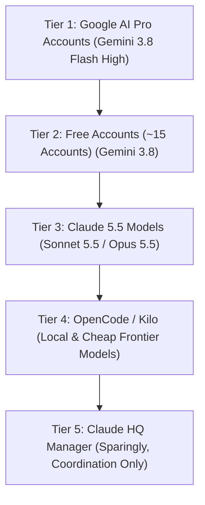

# SIR QUOTA & MODEL ROTATION ARCHITECTURE
**Target**: Autonomous Gemini HQ Manager & Antigravity Engineers  
**Standard**: Master Directive (`00-master-directive.md`), Usage Policy (`USAGE_POLICY.md`)  
**Scope**: All Portfolio Autonomous Operations · Version: 1.0.0 (Strictly enforced)

---

## 1. Executive Summary & Core Principle
To ensure that all 17 projects progress autonomously around the clock without ever hitting a hard stall, Antigravity account and model quotas must be managed like finite capital. 

**The Golden Rotation Rule (Ahmed, 2026-11-09)**:
> Switch accounts BEFORE exhaustion. When ANY active account's Gemini 5-hour window or weekly limit reaches **15% remaining or less**, trigger automatic rotation immediately. Never wait for 0% or for an unhandled `RESOURCE_EXHAUSTED` error.

---

## 2. Model & Account Hierarchy (Strict Order of Execution)

Work proceeds down this strict priority ladder:



### Tier 1: Google AI Pro Accounts (Gemini 3.8 Flash High)
All builder and auditor work runs first on Ahmed's Pro accounts in this verified order:
1. `a7medorabe7@gmail.com` (Primary Pro account)
2. `a01083835229@gmail.com` (Secondary Pro account)
3. `1sir1ahmed1@gmail.com` (Tertiary Pro account)
4. `ahmedalaa2006.7.6@gmail.com` (Quaternary Pro account)

*Protocol*: Run Gemini 3.8 Flash High until the 5-hour limit drops to <=15% or weekly drops to <=10%. Then immediately switch to the next account in the list.

### Tier 2: Free Tier Accounts (~15 Accounts)
When all Tier 1 accounts are temporarily constrained by their 5-hour rolling windows:
- Rotate through the pool of verified free Google accounts using the exact same chooser script.
- Free accounts handle spec reading, unit test authoring, linting, formatting, documentation, and verification sweeps.

### Tier 3: High-Tier Claude Models (Sonnet 5.5 / Opus 5.5)
- Reserved exclusively for complex architectural deadlocks, deep security reviews, or when Gemini encounters a recursive blocker.
- **Prohibited**: Claude 4.x (e.g., Claude 4.6 is obsolete and strictly banned per owner directive).

### Tier 4: OpenCode / Kilo CLI Operators
- Local or API-backed cheap high-throughput models executing automated bulk refactors, script executions, and AST linting.

### Tier 5: Autonomous HQ Manager
- Operates sparingly as the master coordinator. HQ dispatches tasks to workers rather than doing heavy code synthesis directly.

---

## 3. Account Rotation Automation Procedure

Account switching is verified to take under 3 minutes without requiring password entry (session cookies in Chrome):

```powershell
# Step 1: Automated account sign-in via Chrome account chooser
python D:\Projects\_SIR\scripts\agy-chooser.py <target_email>

# Step 2: Uncheck data-sharing checkbox and confirm Antigravity startup

# Step 3: Read current quota numbers from Settings > Models & Usage
# Record updated percentages and reset timestamps in:
# D:\Projects\_SIR\ops\ACCOUNT_LEDGER.md
# D:\Projects\_SIR\ops\agy-accounts-usage.md

# Step 4: Resume all active chats by issuing 'continue'
```

---

## 4. Quota Ledger & Tracking Format

Every rotation must append a timestamped entry to `D:/Projects/_SIR/ops/ACCOUNT_LEDGER.md`:

| Timestamp | Account | 5h Quota Left | Weekly Quota Left | 5h Reset In | Weekly Reset In | Models Available | Next Action |
|---|---|---|---|---|---|---|---|
| 2026-11-09T19:30 | a7medorabe7 | 100% | 10% | Rolling | 4d 6h | Gemini 3.8 High | Rotate to a01083835229 |
| 2026-11-09T19:35 | a01083835229 | 59% | 45% | 4h 25m | 6d 5h | Gemini 3.8, Sonnet 5.5 | Active builder execution |

---

## 5. Risk Matrix: What Happens If Everything Is Exhausted?

| Risk Scenario | Probability | Impact | Automated Mitigation & Recovery |
|---|---|---|---|
| **5h Window Cap Hit on all Pro Accounts** | Medium | Low | Switch to Tier 2 (free accounts) or wait for rolling 5h window to unlock (oldest account resets in <2 hours). |
| **Weekly Pro Quota Depleted across all 4 Pro Accounts** | Low | High | Shift all autonomous building to Free Tier pool and local Ollama models (`AI_Models_Hub`) for non-stop offline progress. |
| **Session Cookie Invalidation / Password Required** | Low | Medium | Chooser script flags "Auth Challenge"; task is paused; single 1-click notification sent to Chairman via Telegram. |
| **Complete Portfolio Quota Collapse (All accounts exhausted)** | Very Low | Critical | 1. Immediately pause batch task runners.<br>2. Force write all in-memory buffers to `.sir/CHECKPOINT.md`.<br>3. Commit all repos straight to `main`.<br>4. Dispatch Telegram Emergency Alert to Ahmed with exact reset timestamps. |

---

## 6. Token Conservation Rules for Antigravity Workers

To maximize work per unit of quota:
1. **Compact at 150k Tokens**: Trigger session restart or compaction when transcript approaches 150,000 tokens.
2. **Read Line Ranges, Never Full 1,000-Line Files**: Always provide `StartLine` and `EndLine` to `read_file`.
3. **No Polling Loops**: Never poll commands or tasks; Antigravity wakes up reactively.
4. **Local Model Execution**: Run bulk tasks, spell checking, and AST parsing locally via `_SIR/scripts/ai/ask.ps1` connected to `AI_Models_Hub`.
