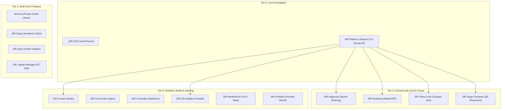

# SIR MASTER TASK BACKLOG (All 17 Projects Consolidated)
**Target**: Autonomous Gemini HQ Manager & Antigravity Engineers  
**Standard**: Standards 23 to 27 · Version: 1.0.0 (Strictly enforced)

---

## Portfolio Dependency Graph & Priority Order

---

## 1. _SIR (HQ & Operations Control Room)
*Repository: `D:\Projects\_SIR` · Priority: Tier 0 (Autonomous Headquarters)*

| ID | Task Title | Target Files | Dependencies | Acceptance Criteria |
|---|---|---|---|---|
| **HQ-01** | Account Chooser Automation Hardening | `scripts/agy-chooser.py` | None | Chooser switches accounts in Chrome in < 180s without user prompt. |
| **HQ-02** | Automated Quota Ledger Sync Daemon | `scripts/sync_quota_ledger.py` | HQ-01 | Automatically parses usage JSON and updates `ops/ACCOUNT_LEDGER.md`. |
| **HQ-03** | Stale Lock Auto-Purge Worker | `scripts/purge_locks.py` | None | Purges lock files older than 2 hours; leaves active locks untouched. |
| **HQ-04** | Telegram Briefing Markdown Formatter | `scripts/deliver/format-briefing.js` | None | Converts markdown reports into clean, unclipped Arabic Telegram alerts. |
| **HQ-05** | Control Room Responsive Table Polish | `ops/dashboard.html` | None | All tables wrap cleanly at 320px; zero white borders or clipped status pills. |

---

## 2. SIR Platform (Shared UI Kit, Motion & Resilience Library)
*Repository: `D:\Projects\SIR Platform` · Priority: Tier 0 (Shared Foundation)*

| ID | Task Title | Target Files | Dependencies | Acceptance Criteria |
|---|---|---|---|---|
| **PLAT-01** | Dynamic Island Spring Engine Component | `packages/ui/src/island/SpringIsland.tsx` | None | Cubic-bezier(0.16, 1, 0.3, 1) transition; verified 60fps in DevTools. |
| **PLAT-02** | Active-Only Animated Tab Bar | `packages/ui/src/navigation/ActiveTabBar.tsx` | PLAT-01 | Inactive tabs render SVG icon only; active expands to icon + text. |
| **PLAT-03** | CSS Logical Properties RTL Normalizer | `packages/styles/src/rtl.css` | None | Normalizes padding, margin, and borders for seamless Arabic RTL flipping. |
| **PLAT-04** | VisualViewport Safe Mobile Input Hook | `packages/hooks/src/useVisualViewport.ts` | None | Dynamically sets `--vvh` property; zero virtual keyboard layout breakages. |
| **PLAT-05** | Paymob & Fawry EGP Test Checkout Modal | `packages/payments/src/PaymobModal.tsx` | None | Renders Paymob iframe/modal with "Launching Soon" fallback on missing key. |

---

## 3. SIR Hagoozat (Sports Venue Booking Engine)
*Repository: `D:\Projects\SIR Hagoozat` · Priority: Tier 1 (Immediate Commercial Cashflow)*

| ID | Task Title | Target Files | Dependencies | Acceptance Criteria |
|---|---|---|---|---|
| **HAG-01** | Venue Real-Time Slot Grid Component | `src/components/venue/SlotGrid.tsx` | PLAT-01 | Interactive 30-min slot selector with instant availability highlights. |
| **HAG-02** | Split-Payment Flow Architecture | `src/services/payments/splitPayment.ts` | PLAT-05 | Divides pitch booking fee between 2–10 players via shareable payment links. |
| **HAG-03** | Paymob Mobile Wallet Webhook Handler | `src/app/api/webhooks/paymob/route.ts` | None | Validates HMAC signature; updates booking status atomically in database. |
| **HAG-04** | WhatsApp Instant Ticket Notification | `src/services/notifications/whatsapp.ts` | None | Sends booking QR code ticket and Google Maps link to player WhatsApp. |
| **HAG-05** | Venue Manager Fast Calendar View | `src/components/manager/VenueCalendar.tsx` | PLAT-02 | Mobile-responsive venue manager calendar with drag-to-reschedule. |

---

## 4. SIR Business (Commercial ERP & POS Suite)
*Repository: `D:\Projects\SIR Business` · Priority: Tier 1 (SaaS Retail, Restaurant, Pharmacy)*

| ID | Task Title | Target Files | Dependencies | Acceptance Criteria |
|---|---|---|---|---|
| **BIZ-01** | Egyptian Tax Authority (ETA) Invoice Formatter | `src/services/tax/etaInvoice.ts` | None | Formats JSON receipt to exact ETA e-receipt API v1.0 standard with Tax ID. |
| **BIZ-02** | Offline-First POS Barcode Scanner | `src/components/pos/BarcodeScanner.tsx` | PLAT-01 | Fast camera & USB barcode scanner input with local IndexedDB cache. |
| **BIZ-03** | Multi-Branch Inventory Sync Engine | `src/services/inventory/syncEngine.ts` | None | Atomic stock decrement across branches with conflict resolution. |
| **BIZ-04** | Restaurant Kitchen Order Display (KOD) | `src/components/restaurant/KitchenDisplay.tsx`| PLAT-02 | Real-time order cards with color-coded preparation timers and alerts. |
| **BIZ-05** | ZATCA Phase 2 QR Code Generator (KSA) | `src/services/tax/zatcaQr.ts` | None | Generates Base64 TLV QR code for Saudi e-invoicing compliance. |

---

## 5. SIR Obour Hub (Academic Campus Platform)
*Repository: `D:\Projects\SIR Obour Hub` · Priority: Tier 1 (Campus Marketplace)*

| ID | Task Title | Target Files | Dependencies | Acceptance Criteria |
|---|---|---|---|---|
| **OBOUR-01** | Academic Course Material R2 Vault | `src/services/storage/r2Vault.ts` | None | Secure upload & signed download URLs for student lecture summaries. |
| **OBOUR-02** | Student Exam Timetable & Conflict Detector | `src/components/academic/Timetable.tsx` | PLAT-01 | Displays personalized exam dates with automatic room and conflict checks. |
| **OBOUR-03** | Peer-to-Peer Used Book Marketplace | `src/components/market/BookMarket.tsx` | PLAT-02 | WhatsApp direct-chat seller contact button with zero platform middleman fees. |
| **OBOUR-04** | Student Union Event Registration | `src/components/events/EventRegister.tsx` | None | Instant QR pass generation for campus workshops and seminars. |
| **OBOUR-05** | Academic Assistant AI Grounding | `src/services/ai/academicAssistant.ts` | None | RAG pipeline answering course syllabi questions grounded in syllabus docs. |

---

## 6. SIR Negm Furniture (Friend's Furniture Brand & 3D Catalog - Handoff Spec)
*Repository: `D:\Projects\SIR Negm Furniture` · Priority: Tier 1 (Plans Complete; Friend Handoff)*

| ID | Task Title | Target Files | Dependencies | Acceptance Criteria |
|---|---|---|---|---|
| **NEGM-01** | WebGL 3D Room Furniture Customizer | `src/components/3d/FurnitureViewer.tsx` | PLAT-01 | Three.js / React Three Fiber interactive 3D model viewer with fabric switcher. |
| **NEGM-02** | Mobile AR Room Placement Preview | `src/components/3d/ArPlacement.tsx` | NEGM-01 | WebXR / QuickLook AR button projecting furniture at true 1:1 physical scale. |
| **NEGM-03** | Manufacturing Deposit Paymob Gateway | `src/services/payments/depositGateway.ts`| PLAT-05 | 50% custom manufacturing deposit checkout with instant invoice PDF. |
| **NEGM-04** | WhatsApp Furniture Inquiry Direct Link | `src/components/catalog/InquiryButton.tsx`| None | Pre-fills furniture SKU, dimensions, and fabric selection into WhatsApp chat. |
| **NEGM-05** | Friend Admin Handoff Dashboard | `src/components/admin/HandoffDashboard.tsx`| PLAT-02 | Ultra-simple Arabic catalog manager for adding products, prices, and photos. |

---

## 7. SIR Content Creation Studio (AI Social Video & Automation Suite)
*Repository: `D:\Projects\SIR Content Creation Studio` · Priority: Tier 2 (Creator SaaS)*

| ID | Task Title | Target Files | Dependencies | Acceptance Criteria |
|---|---|---|---|---|
| **CCS-01** | Programmatic Dynamic Video Subtitler | `src/services/video/subtitleEngine.ts` | None | Generates kinetic animated subtitles with word-by-word active highlighting. |
| **CCS-02** | Multi-Platform Video Aspect Ratio Cropper | `src/services/video/aspectCropper.ts` | None | FFmpeg-based auto-reframe from 16:9 to 9:16 vertical video with speaker tracking. |
| **CCS-03** | Meta Graph API Scheduled Publisher | `src/services/social/metaPublisher.ts` | None | Uploads reels and carousels via official Instagram Graph API with retry. |
| **CCS-04** | YouTube Data API v3 Shorts Publisher | `src/services/social/youtubePublisher.ts`| None | Automated upload with tags, localized description, and custom thumbnail. |
| **CCS-05** | Creator Brand Kit Voice & Color Manager | `src/components/brand/BrandKitManager.tsx` | PLAT-02 | Stores typography tokens, color palettes, and watermarks for video rendering. |

---

## 8. SIR AI (Frontier Desktop AI Agent & Local Router)
*Repository: `D:\Projects\SIR AI` · Priority: Tier 2 (Desktop Frontier Client)*

| ID | Task Title | Target Files | Dependencies | Acceptance Criteria |
|---|---|---|---|---|
| **AI-01** | Local Ollama Connection Bridge | `src/services/llm/ollamaBridge.ts` | None | Connects to `D:\Projects\AI_Models_Hub`; streams tokens with < 50ms TTFT. |
| **AI-02** | Universal Multi-Provider Failover Router | `src/services/llm/fallbackRouter.ts` | None | Auto-routes: Ollama Local -> OpenRouter -> Cloud API on latency timeout. |
| **AI-03** | Desktop Floating Query Bar (Alt+Space) | `src-tauri/src/tray/queryBar.rs` | None | Native global hotkey launcher showing transparent spring-animated prompt. |
| **AI-04** | Document RAG Pipeline with Local Embeddings| `src/services/rag/localEmbeddings.ts` | None | Local vector store querying personal PDF/DOCX files with zero cloud leakage. |
| **AI-05** | Private Conversation Vault (Encrypted SQLite)| `src/services/storage/encryptedVault.ts` | None | AES-256 encrypted chat history stored strictly on local disk. |

---

## 9. SIR Controller (Windows Latency Tuner & PC Optimizer)
*Repository: `D:\Projects\SIR Controller` · Priority: Tier 2 (PC Gaming & Latency Tool)*

| ID | Task Title | Target Files | Dependencies | Acceptance Criteria |
|---|---|---|---|---|
| **CTRL-01** | Silent Background Hardware Telemetry Daemon| `src-core/telemetry/hardwareDaemon.py` | None | Samples CPU/GPU/RAM metrics silently using `CREATE_NO_WINDOW = 0x08000000`. |
| **CTRL-02** | Safe Registry Gaming Latency Profile | `src-core/tweaks/gamingProfile.py` | None | Applies safe network throttle index tweaks with 1-click restore registry backup. |
| **CTRL-03** | Disk Cache & Temporary File Cleaner | `src-core/cleaner/diskCleaner.py` | None | Frees regenerable cache safely; never touches user documents or game saves. |
| **CTRL-04** | Process Affinity & Priority Balancer | `src-core/optimizer/priorityBalancer.py` | None | Dynamically sets game process priority to High and background daemons to BelowNormal. |
| **CTRL-05** | Real-Time Latency & FPS In-Game HUD | `src-ui/components/hud/LatencyOverlay.tsx` | PLAT-01 | Lightweight DirectX/DirectWrite transparent overlay showing live frame time. |

---

## 10. SIR Laptop Manager (Personal Hardware & Automation Agent)
*Repository: `D:\Projects\Laptop manager` · Priority: Tier 1 (Private Executive Engine)*

| ID | Task Title | Target Files | Dependencies | Acceptance Criteria |
|---|---|---|---|---|
| **LAP-01** | Multi-Tool Cross-Config Sync Routine | `scripts/sync_configs.py` | None | Reconciles VS Code, Cursor, Antigravity, and Windows Terminal profiles. |
| **LAP-02** | Storage Guardian Early-Warning Daemon | `scripts/storage_guardian.py` | None | Alarms on Telegram when Drive D: drops below 40GB free space. |
| **LAP-03** | Battery Care & Charging Threshold Tuner | `scripts/battery_tuner.py` | None | Monitors battery wear level and notifies on excessive thermal discharge. |
| **LAP-04** | Local Model Repository Integrity Checker | `scripts/check_ai_models.py` | None | Scans `D:\Projects\AI_Models_Hub` to verify GGUF model hashes and paths. |
| **LAP-05** | Windows Startup Silent Task Scheduler | `scripts/register_silent_tasks.ps1` | None | Registers startup routines via Task Scheduler without flashing cmd consoles. |

---

## 11. AHome (Private Smart Home & Family Memory Vault)
*Repository: `D:\Projects\AHome` · Priority: Tier 1 (STRICTLY PRIVATE - ZERO OUTSIDE TELEMETRY)*

| ID | Task Title | Target Files | Dependencies | Acceptance Criteria |
|---|---|---|---|---|
| **AH-01** | Air-Gapped Local Home Assistant Bridge | `src/services/iot/homeAssistantBridge.ts`| None | Connects to local Zigbee/Matter hub via WebSocket; zero external cloud routing. |
| **AH-02** | Private Local Memory Vault UI | `src/components/family/MemoryVault.tsx` | PLAT-01 | Password-protected gallery with client-side encryption for Habiba photos. |
| **AH-03** | Offline Voice Command Keyword Spotter | `src/services/voice/keywordSpotter.ts` | None | Local wake-word detection running lightweight ONNX model completely offline. |
| **AH-04** | Smart Home Energy & Device Scheduler | `src/components/home/DeviceScheduler.tsx` | PLAT-02 | Visual schedule editor for air conditioners, lights, and appliances. |
| **AH-05** | Local Encrypted SQLite Backup Routine | `scripts/backup_vault_local.py` | None | Automated daily encrypted archive to `D:\Projects\Backups\AHome\`. |

---

## 12. SIR Study (Private Academic Workspace & Exam Flashcards)
*Repository: `D:\Projects\SIR Study` · Priority: Tier 2 (Student Academic Toolkit)*

| ID | Task Title | Target Files | Dependencies | Acceptance Criteria |
|---|---|---|---|---|
| **STD-01** | Spaced Repetition Flashcard Engine (SM-2)| `src/services/study/sm2Algorithm.ts` | None | Implements SuperMemo SM-2 interval scheduling for CS exam flashcards. |
| **STD-02** | Markdown & KaTeX Math Note Editor | `src/components/notes/KaTexEditor.tsx` | PLAT-01 | Real-time dual-pane editor rendering LaTeX formulas with zero cursor jump. |
| **STD-03** | Course Curriculum Progress Tracker | `src/components/curriculum/ProgressMap.tsx`| PLAT-02 | Visual node graph showing completed modules, credit hours, and GPA targets. |
| **STD-04** | PDF Lecture Slide Annotation Layer | `src/components/pdf/SlideAnnotator.tsx` | None | Canvas overlay for highlighting and adding sticky margin notes to PDF slides. |
| **STD-05** | Offline Flashcard Sync to Phone via Local Wi-Fi| `src/services/sync/localWifiSync.ts` | None | Direct local network sync between laptop and mobile without cloud servers. |

---

## 13. SIR Jobs (Private Career Autopilot & Application Engine)
*Repository: `D:\Projects\SIR Jobs` · Priority: Tier 2 (Private Career Automation)*

| ID | Task Title | Target Files | Dependencies | Acceptance Criteria |
|---|---|---|---|---|
| **JOB-01** | Resume Keyword ATS Match Scorer | `src/services/ats/atsScorer.ts` | None | Analyzes resume PDF against target job description and outputs % match. |
| **JOB-02** | Job Application Pipeline Kanban Board | `src/components/kanban/JobPipeline.tsx` | PLAT-01 | Drag-and-drop board tracking Wishlist -> Applied -> Interview -> Offer stages. |
| **JOB-03** | Customized Cover Letter Generator | `src/services/ai/coverLetterGen.ts` | None | Uses local Ollama model to generate personalized cover letter based on facts. |
| **JOB-04** | Interview Preparation Question Bank | `src/components/interview/QuestionBank.tsx`| PLAT-02 | Curated technical questions for junior/mid-level AI engineering roles. |
| **JOB-05** | Encrypted Job Vault Export | `src/services/export/jobVaultExport.ts` | None | Exports entire application history and recruiter notes as encrypted JSON. |

---

## 14. SIR Life (Holistic Habits, Health & Daily Routines)
*Repository: `D:\Projects\SIR Life` · Priority: Tier 3 (Personal Lifestyle Engine)*

| ID | Task Title | Target Files | Dependencies | Acceptance Criteria |
|---|---|---|---|---|
| **LIFE-01** | Visual Habit Heatmap Grid (GitHub Style) | `src/components/habits/HeatmapGrid.tsx` | PLAT-01 | Year-long streak matrix displaying daily habit completion with color depth. |
| **LIFE-02** | Dual Gregorian & Hijri Prayer Schedule | `src/services/calendar/prayerTimes.ts` | None | Accurate Egyptian General Authority of Survey prayer calculation engine. |
| **LIFE-03** | Hydration & Screen Break Audio Chime | `src/services/health/breakReminders.ts` | None | Gentle periodic chime reminding user to hydrate and rest eyes (20-20-20 rule). |
| **LIFE-04** | Daily Evening Review & Reflection Drawer | `src/components/review/EveningDrawer.tsx` | PLAT-02 | Smooth spring-animated bottom sheet for logging 3 daily wins and learnings. |
| **LIFE-05** | Local Data Privacy Export & Purge Flow | `src/services/privacy/dataPrivacy.ts` | None | 1-click JSON export and complete local database wipe complying with GDPR. |

---

## 15. SIR ModPack (Minecraft Mod Management & Launcher Suite)
*Repository: `D:\Projects\SIR ModPack` · Priority: Tier 3 (Gaming Community Software)*

| ID | Task Title | Target Files | Dependencies | Acceptance Criteria |
|---|---|---|---|---|
| **MOD-01** | Fabric / Forge Modpack Dependency Resolver | `src-core/resolver/modResolver.py` | None | Solves Java/Fabric mod version compatibility graph and flags conflicting IDs. |
| **MOD-02** | Fast Mirror Chunk Downloader | `src-core/downloader/chunkDownloader.py` | None | Multi-threaded resumable mod downloader with SHA-256 hash verification. |
| **MOD-03** | Lightweight Desktop Launcher Shell | `src-ui/components/launcher/LauncherUI.tsx`| PLAT-01 | Clean game launcher window with 1-click launch and memory allocation slider. |
| **MOD-04** | Server Ping & Player Count Status Widget | `src-ui/components/status/ServerStatus.tsx`| PLAT-02 | Live TCP handshake displaying server online status, latency, and active players. |
| **MOD-05** | Crash Report Analyzer & Plain Error Explainer| `src-core/analyzer/crashAnalyzer.py` | None | Parses Java stack trace and identifies offending mod name in plain words. |

---

## 16. SIR Mods for GTA V (GTA V Optimization & Modding Suite)
*Repository: `D:\Projects\SIR Mods for GTA V` · Priority: Tier 3 (Modding Suite)*

| ID | Task Title | Target Files | Dependencies | Acceptance Criteria |
|---|---|---|---|---|
| **GTA-01** | Clean Game Directory Snapshot & Backup | `scripts/snapshot_game_dir.py` | None | Creates differential backup of original GTA V `.rpf` and `.dll` game files. |
| **GTA-02** | 1-Click Online Safe Mode Switcher | `scripts/safe_mode_switcher.py` | None | Quarantines all mod files to `_quarantine\` to prevent GTA Online anti-cheat bans. |
| **GTA-03** | Vehicle & Texture Mod Installer GUI | `src/components/installer/ModInstaller.tsx`| PLAT-01 | Drag-and-drop `.oiv` / texture installer with live vehicle 3D preview. |
| **GTA-04** | Game Configuration Latency & Shadow Tuner | `scripts/tune_game_settings.py` | None | Optimizes `settings.xml` shadow cascades and texture streaming for high FPS. |
| **GTA-05** | Mod Conflict & Script Hook Version Checker | `scripts/check_scripthook.py` | None | Validates installed ScriptHookV version against latest game build executable. |

---

## 17. SIR Portfolio (Ahmed Oraby Public Portfolio & Founder Site)
*Repository: `D:\Projects\SIR Portfolio` · Priority: Tier 2 (Founder Brand & GEO Engine)*

| ID | Task Title | Target Files | Dependencies | Acceptance Criteria |
|---|---|---|---|---|
| **PORT-01** | Dynamic Island Interactive Project Showcase | `src/components/showcase/ProjectShowcase.tsx`| PLAT-01 | Expandable project card displaying live preview, tech stack, and GitHub link. |
| **PORT-02** | Clean Arabic & English Bi-Directional Switcher| `src/components/locale/LanguageSwitcher.tsx` | PLAT-03 | Instant language flip with zero page reload; persists language preference. |
| **PORT-03** | Generative Engine Optimization Engine (llms.txt)| `public/llms.txt` | None | Publishes comprehensive `llms.txt` detailing Ahmed's background and projects. |
| **PORT-04** | Verified Person Schema (JSON-LD) | `src/components/seo/PersonJsonLd.tsx` | None | Validated schema.org Person data linking GitHub, LinkedIn, and SIR ventures. |
| **PORT-05** | Contact Form with Direct Telegram Dispatch | `src/app/api/contact/route.ts` | None | Submits founder inquiries directly to Ahmed's Telegram bot via webhook. |
