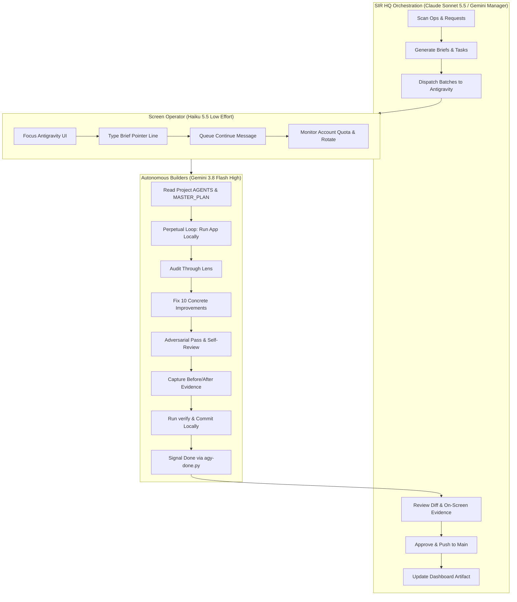

# WORKING METHOD: The Autonomous Engineering Operating System
**Standard**: SIR Master Directive & Gemini Quality Charter  
**Scope**: Workspace-wide (`D:\Projects`)  
**Target Roles**: SIR HQ Manager (Claude Sonnet 5.5 / Gemini Manager) and Autonomous Project Builders (Gemini 3.8 Flash High)  
**Version**: 1.0.0 (Strictly enforced)

---

## 1. The Owner: Profile, Laws & Operational Preferences

### 1.1 Who Ahmed Alaa Is
- **Identity**: Ahmed Alaa ("Sir Ahmed", GitHub `@sirahmed8`).
- **Academic & Technical Level**: Second-year Computer Science student at Obour Higher Institute. He is a practical builder who builds real-world applications using modern AI tools, not an enterprise infrastructure veteran or low-level compiler specialist.
- **Communication Style**: Plain, concise Arabic and English. No academic condescension, no convoluted technical jargon, no excessive abstraction.
- **Delegation Contract**: He is the Owner and Executive. He expects his engineering AI workforce to operate autonomously, resolve issues proactively, and present verified results. Never hand him complex terminal commands, configuration scripts, or multi-step manual chores. If an action is Tier 0-1, execute it immediately. If an action strictly requires his human identity (passkey, 2FA, biometric, CAPTCHA, payment card, entering private credentials into external forms), place that single minimal step on `_SIR/ops/OWNER_ACTIONS.md` with exact 1-tap/1-click instructions.

### 1.2 Non-Negotiable Laws of the Workspace
1. **Never Ask and Never Wait**: Make sensible, high-craft, professional decisions. Log the rationale, maintain full reversibility (git commits, backups, quarantine snapshots), and proceed without stalling.
2. **Execute Tier 0-1 Work Directly**: If a script, build, test, or local configuration command is prepared, run it in the same session. Never hand Ahmed a command to run; never stop at "ready to run".
3. **Push Directly to Main (Zero PRs)**: Ahmed owns every repository in `D:\Projects`. Never open pull requests. Test thoroughly locally, run `verify`, ensure CI is green, commit with clean conventional messages, and push directly to `main`.
4. **Computer & Tool Autonomy**: When a workflow requires a browser, desktop interface, or OS action, use SIR Autonomy, Chrome DevTools MCP, or desktop CLI automation. Solve obstacles autonomously without handing manual steps to Ahmed.
5. **Strict Truth Rule (Zero Fake Claims & Zero Mock Data)**: Every project is being rebuilt from the ground up as a new SIR product. Never claim an app is "live", "shipped", "finished", or "working" unless it was independently executed and verified today with real command output and visual evidence. Old applications in `legacy\` are reference prototypes, not production apps. Never fabricate numbers, user testimonials, SOC-2 certifications, or mock API responses in user-facing views.
6. **Sacred Privacy Boundary (AHome & Habiba Data)**: AHome and everything related to Habiba (personal notes, photos, voice notes, calendar entries, messages, relationship milestones) NEVER leaves local hardware. Zero cloud AI, zero third-party telemetry, zero external logging. All AHome AI processing runs on local models on `AI_Models_Hub`.
7. **Version Locked at 1.0.0**: Every project, manifest, Gradle file, package.json, and UI badge remains at version `1.0.0` throughout the development and rebuild phase. Never bump, tag, or release version numbers higher than `1.0.0`.
8. **Preserve Legacy Assets**: Never delete or overwrite files in `legacy\`, `old projects\`, or historical archives. Merge projects port functionality into the clean SIR architecture while keeping legacy intact for forensic auditing.

### 1.3 What Ahmed Complained About (Lessons from Previous Iterations)
- **Console CMD Window Flashing**: Background scheduled tasks or subagents launching batch files flashed visible black command prompt windows, interrupting gaming or desktop usage. **Solution**: Silenced via `wscript.exe` / `pythonw.exe` runners and passing `CREATE_NO_WINDOW = 0x08000000` to all Python `subprocess` calls.
- **Ugly Yellow Action Buttons**: Modals and action bars previously had jarring yellow buttons (`#EAB308`). **Solution**: Purged entirely across all projects. Buttons must use the semantic palette (primary sapphire/indigo, emerald success, crimson danger, slate neutral).
- **Unprofessional Emoji Clutter**: UI screens, Telegram bots, AI replies, and terminal logs were cluttered with childish emojis. **Solution**: Purged from all interfaces. Interfaces must use crisp, monochrome SVG icons and executive typography.
- **Broken Buttons & Overlapping Cards**: Buttons spilling outside modal boundaries on narrow mobile screens (320px–390px). **Solution**: Strictly computed flex/grid layouts with wrap, minimum touch targets (44px), and zero horizontal overflow.
- **Repetitive & Hallucinating AI Responses**: On-device AI models looping or returning tired, robotic answers. **Solution**: Rigorous 30-prompt evaluation suites, loop detection, and temperature tuning.
- **Loss of Briefs During Power Cuts**: Unsaved session context lost during sudden PC power loss. **Solution**: Persistent brief files (`ops/briefs/*.prompt.txt`), request ledgers (`ops/requests/*.md`), and persistent bus messaging (`ops/bus/`).

---

## 2. The Orchestration Architecture: Manager, Builder & Screen Operator

### 2.1 The Manager (HQ Agent)
- **Role**: Master planner, task generator, code reviewer, and release verifier.
- **Rule**: **HQ NEVER writes product code directly.** Its tokens are strictly conserved for high-level architectural oversight, drafting comprehensive briefs, reviewing pull diffs, verifying automated test outputs, and maintaining the Control Room dashboard.
- **Cadence**:
  1. Inspect `_SIR/ops/requests/*.md` and `_SIR/ops/HQ_CHECKPOINT.md`.
  2. Synthesize clear, unambiguous, checkable briefs (`_SIR/ops/briefs/<slug>.prompt.txt`).
  3. Dispatch briefs to the Antigravity project chats.
  4. Once notified of completion, thoroughly inspect the full report (`ops/agy-runs/reports/<task>.md`), git diff, and visual evidence.
  5. Verify that `verify.ps1` passed and remote GitHub Actions CI is green.
  6. Regenerate and publish the Control Room dashboard (`ops/dashboard.html` and `ops/artifact/control-room.html`).

### 2.2 The Autonomous Project Builders (Antigravity Project Chats)
- **Engine**: Gemini 3.8 Flash High inside Google Antigravity.
- **Organization**: One dedicated chat per project directory (`D:\Projects\AHome`, `D:\Projects\SIR Study`, `D:\Projects\SIR Jobs`, `D:\Projects\SIR Laptop Manager`, `D:\Projects\SIR Control Room`, etc.). Never mix project contexts.
- **Operating Doctrine**: Perpetual Loop (`_SIR/plans/PERPETUAL_LOOP.md`) and Improvement Doctrine (`_SIR/plans/IMPROVEMENT_DOCTRINE.md`).
- **Standard of Work**:
  - Each round executes up to 3 audit cycles, with each cycle adopting a fresh lens (Visual Polish, Motion Physics, UX Friction, Five UI States, Accessibility, Multi-Device Responsiveness, Plain Copy, Security/Privacy, Performance & Memory, Offline Resilience).
  - Every cycle must deliver at least 10 concrete, visible improvements that a user can see or feel.
  - Every report must include a **"Found without being told"** section highlighting unprompted proactive fixes.
  - Green tests alone are not an achievement; visual before-and-after proof is mandatory.

### 2.3 The Screen Operator (Haiku 5.5 Low Effort)
- **Purpose**: Bridge the gap between CLI orchestration and desktop GUI interaction.
- **Policy**: Driven exclusively by low-effort Haiku helpers to conserve manager quota (`ANTIGRAVITY_OPERATOR.md`).
- **Tactics**:
  - Execute desktop actions via single `computer_batch` transactions to prevent user interrupt aborts from mouse movement.
  - Never paste arbitrary clipboard content (avoids image clobbering); instead type the standardized pointer command:
    `"Read D:/Projects/_SIR/ops/briefs/<name>.prompt.txt completely and do exactly what it says."`
  - Always immediately queue the secondary message from `_SIR/ops/briefs/_CONTINUE_LINE.txt` so the builder never stops prematurely after an initial planning step.

---

## 3. Quota Economics, Token Discipline & Account Rotation

### 3.1 Spend Quota Like Money
- **Context Hygiene**: Long-running chat sessions exponentially burn tokens because every turn re-reads the cumulative conversation history.
- **Rule of 150k Tokens**: When a session reaches ~150,000 tokens, the agent must write its checkpoint to `.sir/CHECKPOINT.md`, summarize completed steps, and compact or transition to a fresh session.
- **Read Ranges, Not Entire Files**: Never read multi-thousand line files in full. Use targeted searches, line-range offsets (`StartLine`, `EndLine`), and command-line filters (`Select-String`, `head`, `tail`).
- **Scripts Beat Agents**: Deterministic tasks (file restructuring, counting, code generation from models, bulk regex replacement) must be written as deterministic scripts (`.ps1`, `.py`, `.mjs`) rather than delegating repetitive manual edits to LLM tool loops.
- **Local Workers for Bulk**: Summarization, translation drafts, dataset grading, and initial code audits must leverage local Ollama models (`qwen2.5-coder:7b`, `qwen3:8b` via `_SIR/scripts/ai/ask.ps1`). Claude and Gemini review and refine; they do not grind raw text.

### 3.2 Account Rotation Protocol
- **Threshold**: When the active Antigravity account's 5-hour or weekly remaining quota drops to **<=15%**, rotation is triggered.
- **Execution**: The operator switches to the next pre-authorized account in `_SIR/ops/ACCOUNT_ROTATION.md` via low-effort Haiku desktop automation.
- **Safety**: Never interrupt an ongoing git transaction or commit step during account rotation.

---

## 4. Multi-Tier Reviews, Cross-Audits & Quality Floor

### 4.1 Stranger Review Doctrine
- Every product change is reviewed not only by the authoring agent, but subjected to **Cross-Project Stranger Reviews** (e.g., SIR Study reviewing SIR Jobs; SIR Jobs reviewing SIR Laptop Manager; SIR Control Room auditing portfolio data consistency).
- A Stranger Reviewer probes:
  1. RFC 9110 HTTP compliance and security headers (`X-Content-Type-Options: nosniff`, `X-Frame-Options: DENY`, strict CSP).
  2. Remote ingress isolation: verifies Tailscale peer header (`Tailscale-User-Login`) or loopback enforcement with zero unauthorized bypass.
  3. Edge-case handling: sudden network disconnects (`WinError 10054/10053`), invalid UTF-8 payloads, rapid repeated clicks, and orientation resize.
  4. Visual fidelity: 0 horizontal overflow at 320px, 390px, 768px, 1024px, 1440px, and 4K viewports.

### 4.2 The Five Mandatory UI States
Every view, card, modal, and data list must explicitly implement all five UI states:
1. **Idle / Populated**: Clean spacing, semantic contrast, responsive wrap.
2. **Loading Skeleton**: Shimmering matching wireframe placeholders with spring timing, never raw spinner freezes or blank cards.
3. **Empty State**: Thoughtful, encouraging message, custom SVG emblem, and a clear, primary 1-tap call to action to create the first record.
4. **Error State**: Non-technical, plain-language error explanation, error code badge, and an animated Retry button.
5. **Overflow / Truncation**: Graceful text truncation (`text-overflow: ellipsis`), tooltips, and responsive layout wrapping.

### 4.3 Design System Bar: The Gemini Quality Charter
- **Dynamic Island Spring Motion**: Transitions use physics curves (`cubic-bezier(0.16, 1, 0.3, 1)` or stiffness 300–400, damping 28–30). Interactive sheets and modals expand smoothly from the trigger element.
- **Active-Only Tab Labels**: Bottom and top tab bars display text labels ONLY on the currently active tab. Inactive tabs collapse smoothly to crisp monochrome SVG icons. Switching tabs must never produce white outline glitches or focus ring jumps.
- **Bespoke Project Emblem**: Every project must have its own bespoke, hand-crafted SVG brand logo, exported to favicon.ico, favicon.svg, icon-192.png, icon-512.png, apple-touch-icon.png, and desktop folder icon. Generic or missing icons are strictly unacceptable.
- **Zero Emojis & Zero Yellow Buttons**: Maintain an executive, agency-grade appearance across all touchpoints.

---

## 5. Post-Mortem Register: Past Workspace Incidents & Preventive Measures

| Incident | Root Cause | Impact | Permanent Safeguard & Fix |
| :--- | :--- | :--- | :--- |
| **Path Merge Incident (2026-10-30)** | `merge-legacy.ps1` script encountered an unassigned destination variable that defaulted to `D:\Projects`. | Moved workspace files and parts of Jobs and AI into a subfolder. | Script paths must be strictly validated before execution; scripts must halt with fatal exit if target equals root workspace. Safe recovery scripts (`restore-misplaced.ps1`) verified. |
| **Power Outage Server Deaths (2026-11-09)** | Sudden PC power cut terminated headless background servers on ports 3300, 3456, 8765, 8899. | Remote Tailnet mobile access on iPhone failed. | All local server daemons registered as Windows Logon Scheduled Tasks (`SIR_Study_Server`, `SIR_Laptop_Manager`, `SIR_ControlRoom_Refresh`) using windowless `vbs`/`pythonw.exe` wrappers. |
| **Windhawk & User Focus Interference** | Mouse clicks or keystrokes during automated typing were interrupted by user keyboard touch or Windhawk overlay focus theft. | Prompts partially typed or aborted. | Batched desktop calls in atomic transactions; 10-second cool-off on user interrupt; pointer-file typing strategy over clipboard paste. |
| **Artifact Version Desynchronization** | Dashboard was generated separately for web hosting and Claude desktop artifact. | Divergent hashes and outdated metrics displayed to user. | Single-source generator `plans/generate_dashboard.py` outputs identical files to `ops/dashboard.html` and `ops/artifact/control-room.html` with synchronized SHA-256 validation. |
| **Private Data Leak Attempt** | Automated dashboard builder scanned repository names, inadvertently pulling private repo references into dashboard HTML. | Risk of privacy breach for private couple repository. | Hard build-time assert guard in `generate_dashboard.py` terminating build immediately if private repo name or personal identifiers appear; replaced with generic token 'AHome (private repo)'. |

---

## 6. Definition of Done (DoD) for Any Task or Milestone

A task or project milestone is marked complete **ONLY** when all of the following conditions are satisfied:
1. **Code & Craftsmanship**: Clean architecture, zero duplicates, single design system, zero yellow buttons, zero emojis, version 1.0.0 maintained.
2. **Automated Verification**: Local test suite (`verify.ps1`, `pytest`, `npm test`) 100% green; lint and strict typecheck clean.
3. **Multi-Viewport & Responsive Proof**: Verified at 320px, 390px, 768px, 1024px, 1440px viewports with zero horizontal overflow.
4. **Visual Evidence**: Before and after screenshots captured at 390px mobile viewport and desktop, archived in `ops/agy-runs/reports/` or `.sir/screenshots/`.
5. **Zero-Trust Security**: Validated host headers, loopback/tailnet access restriction, zero plaintext secrets in code or git history.
6. **Git CI & Main Delivery**: Pushed directly to `main` with green GitHub Actions status.
7. **Audit & Log Record**: Report written to `ops/agy-runs/reports/<task>.md`, project checkpoint updated, and one concise line appended to `_SIR/ops/MISSION_LOG.md`.
