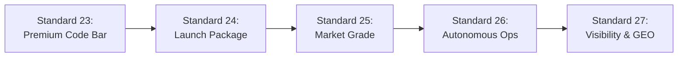
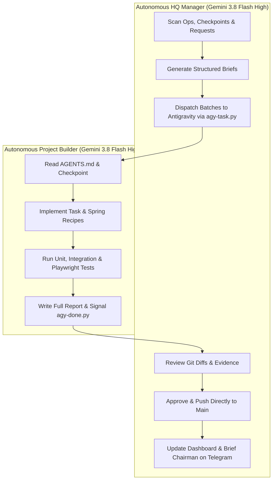

# WORKING METHOD: The Autonomous Engineering Operating System
**Standard**: SIR Master Directive (`00-master-directive.md`), Quality Bar (`23-premium-code-bar.md`), Standards 24–27  
**Scope**: Workspace-wide (`D:\Projects`)  
**Target Roles**: SIR HQ Manager (Gemini 3.8 Flash High / Claude Sonnet 5.5) and Autonomous Project Builders  
**Version**: 1.0.0 (Strictly enforced)

---

## 1. The Owner: Profile, Laws & Operational Preferences

### 1.1 Who Ahmed Alaa Is
- **Identity**: Ahmed Alaa ("Sir Ahmed", GitHub `@sirahmed8`).
- **Academic & Technical Level**: Second-year Computer Science student at Obour Higher Institute. He is a practical builder who builds real-world applications using modern AI tools, not an enterprise infrastructure veteran or low-level compiler specialist.
- **Communication Style**: Plain, concise Arabic and English. No academic condescension, no convoluted technical jargon, no excessive abstraction.
- **Delegation Contract**: He is the Owner and Chairman. He expects his engineering AI workforce to operate autonomously, resolve issues proactively, and present verified results. Never hand him complex terminal commands, configuration scripts, or multi-step manual chores. If an action is Tier 0-1, execute it immediately. If an action strictly requires his human identity (passkey, 2FA, biometric, CAPTCHA, payment card, entering private credentials into external forms), place that single minimal step on `_SIR/ops/OWNER_ACTIONS.md` with exact 1-tap/1-click instructions.

### 1.2 Non-Negotiable Laws of the Workspace
1. **Never Ask and Never Wait**: Make sensible, high-craft, professional decisions. Log the rationale, maintain full reversibility (git commits, backups, quarantine snapshots), and proceed without stalling.
2. **Execute Tier 0-1 Work Directly**: If a script, build, test, or local configuration command is prepared, run it in the same session. Never hand Ahmed a command to run; never stop at "ready to run".
3. **Push Directly to Main (Zero PRs)**: Ahmed owns every repository in `D:\Projects`. Never open pull requests. Test thoroughly locally, run `verify`, ensure CI is green, commit with clean conventional messages, and push directly to `main`.
4. **Computer & Tool Autonomy**: When a workflow requires a browser, desktop interface, or OS action, use SIR Autonomy, Chrome DevTools MCP, or desktop CLI automation. Solve obstacles autonomously without handing manual steps to Ahmed.
5. **Strict Truth Rule (Zero Fake Claims & Zero Mock Data)**: Every project is being rebuilt from the ground up as a new SIR product. Never claim an app is "live", "shipped", "finished", or "working" unless it was independently executed and verified today with real command output and visual evidence. Old applications in `legacy\` are reference prototypes, not production apps. Never fabricate numbers, user testimonials, SOC-2 certifications, or mock API responses in user-facing views.
6. **Sacred Privacy Boundary (AHome & Habiba Data)**: AHome and everything related to Habiba (personal notes, photos, voice notes, calendar entries, messages, relationship milestones) NEVER leaves local hardware. Zero cloud AI, zero third-party telemetry, zero external logging. All AHome AI processing runs on local models on `AI_Models_Hub`.
7. **Version Locked at 1.0.0**: Every project, manifest, Gradle file, package.json, and UI badge remains at version `1.0.0` throughout the development and rebuild phase. Never bump, tag, or release version numbers higher than `1.0.0`.
8. **Preserve Legacy Assets**: Never delete or overwrite files in `legacy\`, `old projects\`, or historical archives. Merge projects port functionality into the clean SIR architecture while keeping legacy intact for forensic auditing.
9. **Project Scope & Negm Furniture Rule (Ahmed, 2026-11-09)**: `SIR Negm Furniture` is **active for planning**—elevated to the same high architectural and market-grade standards as all other SIR products, with a complete turn-key package prepared for handover to his friend. Plans only: do NOT start code building, CI, or deployment until explicitly ordered.
10. **Autonomous Quota Rotation (Ahmed, 2026-11-09)**: Quota is watched for all accounts. When ANY active account drops to **15% remaining or less** (in 5-hour window or weekly), rotate to the next account immediately via `scripts/agy-chooser.py`. Never wait for exhaustion.

### 1.3 What Ahmed Complained About (Lessons from Previous Iterations)
- **Console CMD Window Flashing**: Background scheduled tasks or subagents launching batch files flashed visible black command prompt windows, interrupting gaming or desktop usage. **Solution**: Silenced via `wscript.exe` / `pythonw.exe` runners and passing `CREATE_NO_WINDOW = 0x08000000` to all Python `subprocess` calls.
- **Ugly Yellow Action Buttons**: Modals and action bars previously had jarring yellow buttons (`#EAB308`). **Solution**: Purged entirely across all projects. Buttons must use the semantic palette (primary sapphire/indigo, emerald success, crimson danger, slate neutral).
- **Unprofessional Emoji Clutter**: UI screens, Telegram bots, AI replies, and terminal logs were cluttered with childish emojis. **Solution**: Purged from all interfaces. Interfaces must use crisp, monochrome SVG icons and executive typography.
- **Broken Buttons & Overlapping Cards**: Buttons spilling outside modal boundaries on narrow mobile screens (320px–390px). **Solution**: Strictly computed flex/grid layouts with wrap, minimum touch targets (44px), and zero horizontal overflow.
- **Repetitive & Hallucinating AI Responses**: On-device AI models looping or returning tired, robotic answers. **Solution**: Rigorous 30-prompt evaluation suites, loop detection, and temperature tuning.
- **Loss of Briefs During Power Cuts**: Unsaved session context lost during sudden PC power loss. **Solution**: Persistent brief files (`ops/briefs/*.prompt.txt`), request ledgers (`ops/requests/*.md`), and persistent bus messaging (`ops/bus/`).

---

## 2. The Five Pillars of Every Product Plan (Standards 23–27)

Every project plan and cycle must satisfy five mandatory pillars:

1. **Standard 23 (Premium Code Bar)**: Zero placeholders, zero TODOs, Dynamic Island spring physics (`cubic-bezier(0.16, 1, 0.3, 1)`), active-only animated tab bars, responsive wrapping down to 320px, and zero yellow buttons.
2. **Standard 24 (Launch Package)**: Dedicated repository and domain; support for all applicable platforms with build commands; end-to-end security audit; fair EGP pricing with Paymob/Fawry test checkout and "Launching Soon" fallback; plain-language Owner Activation Checklist.
3. **Standard 25 (Market Grade)**: Researched competitor study saved in `plans/competitors/<slug>.md`; regional regulatory and tax compliance (Egypt ETA, Saudi ZATCA, EU GDPR, US CCPA); privacy-first opt-in analytics; pre-drafted legal pack with honest lawyer review disclaimer.
4. **Standard 26 (Autonomous Operations)**: In-product AI support assistant grounded in verified documentation; comprehensive operations runbook; marketing plan with 12-week launch calendar; Telegram reporting format; strict cost caps ($5/day AI cap, $0 default ad spend).
5. **Standard 27 (Visibility & Discovery)**: High-intent keyword map in Arabic, Egyptian dialect, and English; Generative Engine Optimization via standard `llms.txt` and `/facts` page; JSON-LD structured data; weekly automated AI visibility verification script. (Private projects AHome, Study, Jobs, Laptop Manager remain unlisted and noindex).

---

## 3. The Orchestration Architecture: Manager, Builder & Screen Operator

---

## 4. Quota Economics & The Perpetual Loop

1. **Compact Early**: Restart or compact sessions at 150,000 tokens to prevent reasoning degradation.
2. **Rotational Safety Buffer**: Trigger account rotation via `scripts/agy-chooser.py` when any quota drops to 15% remaining.
3. **Never Stop (Perpetual Loop)**: An autonomous engineering session does not terminate when a single task passes. It inspects the product through a fresh audit lens (UI, UX, motion, accessibility, security, speed, copy), proactively fixes at least 5 subtle defects, and documents them in a dedicated "Found Without Being Told" section.
4. **Project Completion Criterion**: A project is declared complete only when three consecutive audit cycles discover zero actionable defects, and a zero-tolerance Stranger Review confirms 100% compliance with Standards 23 to 27.
