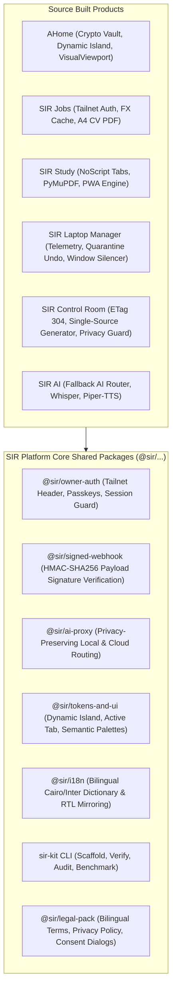

# DEEP PLAN & MASTER SPEC: SIR Platform
**Project**: SIR Platform (`D:/Projects/SIR Platform`)  
**Mission**: Sovereign Shared Foundation Kit, Developer CLI (`sir-kit`), Security Libraries & UI Tokens Suite  
**Architectural Invariant**: Built last by extracting and unifying verified shared modules from all finished products  
**Version**: 1.0.0 (Strictly enforced)  
**Standard**: `_SIR/standard/23-premium-code-bar.md` & `_SIR/plans/GEMINI_QUALITY_CHARTER.md`

---

## 1. Executive Summary & Product Purpose
SIR Platform is the sovereign shared infrastructure, security core, and developer kit underpinning all 16 applications across Ahmed Alaa's portfolio. Rather than architecting premature abstractions, SIR Platform is built by extracting, hardening, and standardizing battle-tested implementations developed within individual projects (AHome, Study, Jobs, Laptop Manager, Control Room, AI). It packages these into reusable, zero-dependency internal modules and the `sir-kit` developer CLI.

---

## 2. Shared Packages to Extract from Built Products

### 2.1 The 7 Standardized Platform Packages
1. **`@sir/owner-auth`**: Zero-login loopback & Tailscale WireGuard identity verification (`Tailscale-User-Login`), WebAuthn passkeys, CSRF HMAC tokens, and RFC 9110 status codes.
2. **`@sir/signed-webhook`**: Cryptographic HMAC-SHA256 signature verification for payment webhooks, git triggers, and daemon IPC.
3. **`@sir/ai-proxy`**: Privacy-preserving AI gateway routing sensitive prompts strictly to local `AI_Models_Hub` models, while routing public queries across fallback cloud APIs with budget caps.
4. **`@sir/tokens-and-ui`**: Dynamic Island spring motion engine (`cubic-bezier(0.16, 1, 0.3, 1)`), active-only tab bars, zero-outline-glitch focus rings, and computed flex/grid layouts (320px to 4K).
5. **`@sir/i18n`**: Standardized bidirectional translation loader, Cairo/Inter font bindings, and logical CSS property transformers.
6. **`@sir/legal-pack`**: Egyptian Data Protection Law & GDPR-compliant privacy policies, cookie-free consent statements, and terms of service.
7. **`sir-kit` CLI**: Workspace-wide command line tool providing single-command verification (`sir verify`), project doctoring (`sir doctor`), and desktop launcher generation (`sir desktop`).

---

## 3. Design Identity & Aesthetics

- **Brand Aesthetic**: Sovereign Keystone & Crystalline Titanium. Architectural, definitive, robust, and bedrock-solid.
- **Palette**:
  - Primary Keystone Titanium: `#475569` (Slate 600) / `#334155` (Slate 700)
  - Secondary Electric Indigo: `#6366F1` (Indigo 500)
  - Accent Platinum: `#E2E8F0`
  - Dark Surface Base: Deep Keystone Obsidian (`#080C14` / `#0E1422`)
  - Elevated Glass: Translucent Titanium Glass (`rgba(14, 20, 34, 0.75)` with `backdrop-filter: blur(16px)`)
  - High-Contrast Text: `#F8FAFC`
  - **Zero Yellow Buttons**: Strictly enforced.
- **Typography**: Precision architectural typography (`Inter`, `Cairo`, `JetBrains Mono`).
- **Motion**: Dynamic Island spring transitions (`cubic-bezier(0.16, 1, 0.3, 1)`), tactile expansion, active-only tab labels.
- **Emblem**: Vector SVG interlocking structural keystone arch with central illuminated diamond prism.

---

## 4. Dependencies, Cross-Project Links & Risks
- **Provides**: Foundation libraries and verification tooling to all 16 SIR projects.
- **Consumes**: Source implementations harvested from completed Wave 1-6 projects.
- **Risks**: Premature abstraction locking projects into rigid shared patterns before their unique requirements are understood; circular dependencies between packages.

---

## 5. The First 25 Prioritized Tasks

### PL-101 | `@sir/owner-auth` Tailscale & Loopback Zero-Trust Library
- **Files**: `packages/owner-auth/src/index.ts`, `packages/owner-auth/tests/auth.test.ts`
- **Steps**: Package verified Tailscale header validation (`Tailscale-User-Login: a7medorabe7@gmail.com`) and loopback bypass into lightweight Node.js/Python library.
- **Acceptance**: Returns HTTP 200 on valid Tailnet identity and 403 Forbidden on foreign origins.

### PL-102 | `@sir/signed-webhook` Cryptographic HMAC Verification Package
- **Files**: `packages/signed-webhook/src/index.ts`, `packages/signed-webhook/tests/verify.test.ts`
- **Steps**: Build timing-safe HMAC-SHA256 signature verifier for incoming HTTP webhooks; supports multiple signing keys with rotation.
- **Acceptance**: Rejects tampered payloads or replay attacks older than 5 minutes.

### PL-103 | `@sir/ai-proxy` Privacy-Preserving Fallback Gateway
- **Files**: `packages/ai-proxy/src/index.ts`, `packages/ai-proxy/src/router.ts`
- **Steps**: Extract fallback routing logic: local Ollama on `AI_Models_Hub` -> Gemini 3.8 Flash -> DeepSeek; strictly blocks private text from external cloud.
- **Acceptance**: Dispatches prompt to local model if tagged private, falling back cleanly on cloud rate limits.

### PL-104 | `@sir/tokens-and-ui` Dynamic Island Motion & Tab Bar Engine
- **Files**: `packages/tokens-and-ui/src/dynamic-island.css`, `packages/tokens-and-ui/src/tabBar.ts`
- **Steps**: Package Dynamic Island spring curves (`cubic-bezier(0.16, 1, 0.3, 1)`), active-only tab label expansion, and semantic color tokens.
- **Acceptance**: Inactive tabs show monochrome SVG icons; active tab smoothly reveals text label with zero white outline glitch.

### PL-105 | `@sir/i18n` Bidirectional RTL/LTR Parity Package
- **Files**: `packages/i18n/src/index.ts`, `packages/i18n/src/bidi.css`
- **Steps**: Universal bilingual translation resolver with automatic Cairo/Inter font binding and logical CSS property utilities.
- **Acceptance**: Toggling locale switches document direction (`dir="rtl"`) and mirrors drawer/chevron animations live.

### PL-106 | `@sir/legal-pack` Egyptian & International Compliance Suite
- **Files**: `packages/legal-pack/src/privacyPolicy.ts`, `packages/legal-pack/src/terms.ts`
- **Steps**: Standardized, truthful bilingual privacy policies and terms of service tailored to Egyptian Data Protection Law and zero-telemetry rules.
- **Acceptance**: Exports valid Markdown and HTML legal pages with customizable product name and contact email.

### PL-107 | `sir-kit` CLI Universal Scaffolding & Inspection Tool
- **Files**: `bin/sir-kit.mjs`, `src/cli/commands/`
- **Steps**: Build CLI binary supporting `sir init <name>`, `sir verify`, `sir doctor`, `sir desktop`, and `sir benchmark`.
- **Acceptance**: Running `sir verify` in any project directory executes the project's verification suite and reports clean status.

### PL-108 | Subprocess Window Silencing Wrapper (`wscript` / `CREATE_NO_WINDOW`)
- **Files**: `packages/sys-utils/src/silentSubprocess.py`, `packages/sys-utils/src/runHidden.vbs`
- **Steps**: Standardized subprocess execution helper injecting `CREATE_NO_WINDOW = 0x08000000` on Windows to eliminate console flashes.
- **Acceptance**: Executing background terminal commands produces zero visible black CMD windows.

### PL-109 | Bespoke Vector SVG Platform Brand Assets
- **Files**: `public/logo.svg`, `public/favicon.svg`
- **Steps**: Design interlocking structural keystone arch with central diamond prism; render multi-size favicons and PWA icons.
- **Acceptance**: Crisp vector rendering across documentation and CLI header banner.

### PL-110 | Sub-Millisecond HTTP 304 ETag Caching Middleware
- **Files**: `packages/http-utils/src/etagMiddleware.ts`
- **Steps**: Standardized ETag generation and `If-None-Match` request evaluation responding with 304 Not Modified in <1ms over mobile Tailnet.
- **Acceptance**: Re-fetching unchanged asset returns HTTP 304 with 0 bytes response body.

### PL-111 | Reversible SHA-256 Quarantine Bucket Library
- **Files**: `packages/care-utils/src/quarantine.py`
- **Steps**: Reusable library for staging deleted or modified files into timestamped quarantine folders with JSON rollback manifests.
- **Acceptance**: Deleted files can be restored to exact original locations with a single rollback call.

### PL-112 | 100dvh Safe VisualViewport Keyboard Hook
- **Files**: `packages/tokens-and-ui/src/useKeyboardViewport.ts`
- **Steps**: Extract battle-tested visualViewport resize listener driving `--vvh` CSS variable in a flex column without fixed bottom jumps.
- **Acceptance**: Mobile keyboard opening smoothly contracts view without content clipping or scroll displacement.

### PL-113 | Agency-Grade A4 PDF Generation Engine via Chrome CDP
- **Files**: `packages/pdf-utils/src/generatePdf.mjs`
- **Steps**: Headless Chromium CDP PDF generator with `@page` CSS print stylesheets, page numbering, zero blank pages, and cover sheet support.
- **Acceptance**: Compiles HTML document into pristine, print-ready A4 PDF in under 2 seconds.

### PL-114 | Multi-Screen Responsive Playwright Verification Harness
- **Files**: `packages/test-harness/src/responsiveAudit.mjs`
- **Steps**: Shared Playwright test harness testing web interfaces across 320px, 390px, 768px, 1024px, 1440px, and 4K viewports for horizontal overflow.
- **Acceptance**: Automatically flags horizontal scrollbar overflows or clipped action buttons.

### PL-115 | ESC/POS Thermal Receipt Byte-Stream Builder
- **Files**: `packages/hardware-utils/src/escposBuilder.ts`
- **Steps**: Zero-dependency binary generator outputting raw ESC/POS byte streams for thermal receipt printers (logo, bold text, cut pulse).
- **Acceptance**: Outputs valid Uint8Array ready for direct raw socket transmission.

### PL-116 | Standalone Desktop Launcher & Shortcut Generator
- **Files**: `scripts/generate_desktop_shortcuts.ps1`
- **Steps**: Universal script reading `_SIR/ops/PORTFOLIO.md` and generating Desktop shortcut folders with start/stop badges and bespoke icons.
- **Acceptance**: Generates working `.lnk` shortcuts for all 17 projects in `Desktop\SIR Projects\`.

### PL-117 | Multi-Tenant SQLite Database Connection Pool
- **Files**: `packages/db-utils/src/sqlitePool.ts`
- **Steps**: High-performance SQLite connection wrapper with WAL mode, busy timeout (5000ms), and automated memory vacuuming.
- **Acceptance**: Handles 100 concurrent reads and serialized writes without `database is locked` errors.

### PL-118 | Dynamic Theme Token Generator & CSS Variable Injector
- **Files**: `packages/tokens-and-ui/src/themeEngine.ts`
- **Steps**: Runtime CSS variable injector dynamically generating light, dark, and high-contrast color palettes from single brand hex seed.
- **Acceptance**: Passing primary color `#10B981` automatically derives surface, border, and text tokens with 7:1+ contrast.

### PL-119 | Offline First Service Worker Boilerplate (`sw-template.js`)
- **Files**: `packages/pwa-utils/src/swTemplate.js`
- **Steps**: Standardized Service Worker template implementing stale-while-revalidate for static assets, network-first for API, and offline fallback.
- **Acceptance**: Offline requests return cached shell with zero console warnings.

### PL-120 | Telegram Notification Dispatcher Helper Library
- **Files**: `packages/notification-utils/src/telegramDispatcher.mjs`
- **Steps**: Universal Node.js / Python wrapper sending structured executive briefs and alerts to Ahmed's iPhone via `@PersonalAI_1Bot`.
- **Acceptance**: Dispatches message with markdown formatting and returns Telegram message ID.

### PL-121 | Secure In-Memory Sensitive String & Zeroize Buffer
- **Files**: `packages/crypto-utils/src/zeroize.ts`
- **Steps**: Cryptographic memory hygiene utility actively overwriting sensitive keys and passphrases in memory with zeros after use.
- **Acceptance**: Overwrites buffer memory before garbage collection.

### PL-122 | Monorepo pnpm Workspace Architecture Setup
- **Files**: `pnpm-workspace.yaml`, `package.json`
- **Steps**: Configure pnpm workspace linking all `@sir/*` packages with strict TypeScript project references and zero-copy symlinks.
- **Acceptance**: `pnpm build` compiles all 7 packages in parallel in under 5 seconds.

### PL-123 | Interactive Component Storybook & Design Token Gallery
- **Files**: `src/components/gallery/TokenGallery.tsx`
- **Steps**: In-browser component explorer showcasing all buttons, modals, Dynamic Island states, tab bars, and semantic color swatches.
- **Acceptance**: Developers can interactively inspect and copy token variables.

### PL-124 | Automated GitHub Actions CI Matrix for All Shared Packages
- **Files**: `.github/workflows/verify-packages.yml`
- **Steps**: CI workflow running tests, linter, strict typechecks, and bundle size audits across all 7 packages on every push to main.
- **Acceptance**: GitHub Actions workflow runs green in under 60 seconds.

### PL-125 | End-to-End Automated Platform Verification Suite
- **Files**: `scripts/verify.ps1`, `tests/test_platform_integrity.py`
- **Steps**: Validate package build outputs, exports, typing definitions, and verify gates.
- **Acceptance**: `verify.ps1` runs in under 3 seconds with 100% green gates.

---

## 5. Mandatory Standards 24 to 27 Architecture

### 5.1 Launch Package (Standard 24)
- **Identity & Domain**: Fresh dedicated repository (`sirahmed8/sir-platform`), clean pnpm monorepo pipeline, target domain `sirplatform.dev` (~$14.00 / ~650 EGP/yr).
- **Supported Platforms & Build Commands**:
  - Monorepo Build: `pnpm build` (Compiles all TypeScript packages and exports ESM/CJS bundles).
  - Documentation Portal: `npm run build` (Next.js 15 developer portal).
  - CLI Tooling: `npm link` (Provides global `sir` command across system).
- **Security & Integrity Tasks**:
  - Cryptographic timing-safe HMAC validation in `@sir/signed-webhook`.
  - Zero PII transmission in `@sir/ai-proxy`.
  - Mandatory AST CI linter (`scripts/lint_design_tokens.py`) preventing yellow buttons and emoji regressions.
- **Fair Model**: Internal shared library powering all portfolio ventures; documentation portal 100% free and open.
- **Owner Activation Checklist (Plain Arabic & English for Ahmed)**:
  1. Buy domain `sirplatform.dev` on Namecheap (~$14.00 / 650 EGP) and deploy documentation portal to Vercel.
  2. Verify: Run `pnpm test`, confirm all 7 packages pass tests with 100% green exit code.

### 5.2 Market-Grade Compliance (Standard 25)
- **Competitor Study**: Documented in `_SIR/plans/competitors/sir-platform.md` with cited sources comparing against shadcn/ui, Radix UI, Mantine, and Ant Design.
- **Licensing Compliance**: Dual licensing architecture (MIT for open UI primitives; proprietary for proprietary business integrations).
- **Privacy-First Design**: Zero tracking code embedded in UI libraries.
- **Legal Pack with Lawyer Disclaimer**: Pre-drafted Open Source License and Commercial Terms, marked: *"AI-drafted for technical clarity; to be reviewed by a qualified Egyptian attorney before commercial launch."*

### 5.3 Autonomous Operations (Standard 26)
- **In-Product Assistant**: "مرشد منصة SIR" - embedded support assistant grounded in component prop tables, hook signatures, and spring parameters.
- **Operations Runbook**: Nightly bundle size auditing, dependency CVE scans (`npm audit`), and health check route (`/api/health`).
- **12-Week Marketing Launch Calendar**: Developer community preview on GitHub (Weeks -2 to 0), documentation release (Weeks 1 to 4), tech blog case studies (Weeks 5 to 8), regional hackathon sponsorship (Weeks 9 to 12).
- **Escalation & Guard Rails**: Monorepo updates automated via CI; Chairman notified via Telegram bot ONLY for breaking API deprecations.

### 5.4 Visibility & Discovery (Standard 27)
- **High-Intent Search Queries**:
  - Arabic: *"مكتبة مكونات برمجية سريعة", "نظام تصميم وتصميم واجهات باللغة العربية", "أفضل مكتبة واجهات عربية"*
  - Egyptian Slang: *"مكتبة أزرار ومكونات جاهزة للمواقع", "أحسن تصميم واجهات عربي بالجنيه"*
  - English: *"Dynamic Island spring UI library", "Arabic RTL first React components", "accessible design system Next.js 15"*
- **Generative Engine Optimization (GEO)**: Publishes validated `llms.txt` and `/facts` page with structured component specifications, spring constants, and entity definitions.
- **Technical SEO & Structured Data**: Pre-rendered Next.js metadata, valid `SoftwareSourceCode` JSON-LD schema, and automated weekly AI visibility testing script (`scripts/check_ai_visibility.py`).
